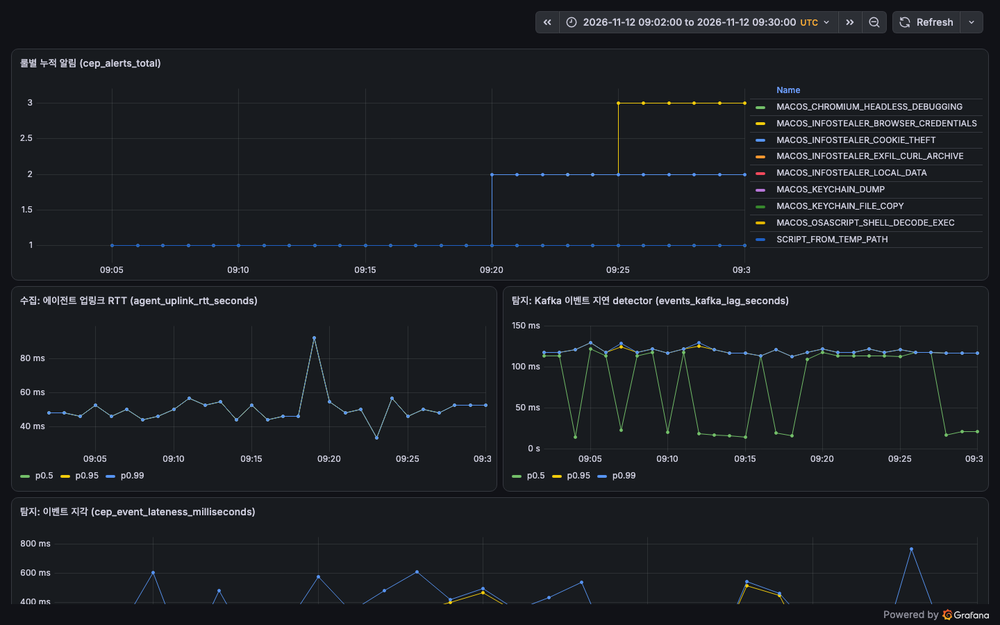

# Atomic Red Team 탐지 시험 결과 (2026-11-12)

공식 성능평가가 아니다. KISA EDR 평가 항목(V1.4)의 수집(BF-14), 탐지(BF-15) 기준으로, Red Canary 의 공개 공격 재현 도구 Atomic Red Team 시험을 실제 단말에서 실행해 잰 자체 시험이다. 시험 목록과 판정 기준은 룰 작성 전에 `../detection-rule-test-list.md` 6절에 고정했다(커밋 `d688ebf`).

## 결론

| 시험 | 결과 |
|---|---|
| 1차(보강 전 룰 3개 없음) | 10 중 7 탐지 |
| 놓친 3개 원인 분석 후 룰 3개 보강, 같은 시험 재실행 | **10 중 10 탐지**, 10개 모두 그 시험을 노린 룰이 잡았다 |
| 11-10 탐지 시험(`../detection-test-2026-11-10/`)과 합산 | 공격 시나리오 **20 중 20 탐지**(자체 시나리오 10 + Atomic Red Team 10). 11-10 의 대조군 6개(룰 범위 밖 기법, 미탐이 정상)는 분모에서 뺐다 |

## 시험 조건

| 항목 | 값 |
|---|---|
| 서버 | 로컬 kind(Kafka, ClickHouse, MySQL, otel-lgtm) + 호스트 bootRun 6개, 브랜치 `feat/sigma-art-coverage`(1차 `cabeebc`, 재시험 `f77c72b`) |
| 단말 | macOS 맥북 1대, 설치된 에이전트 0.4.0 의 설정만 로컬 서버로 돌렸다(바이너리는 그대로, 전체 디스크 접근 유지) |
| 시험 도구 | Atomic Red Team 커밋 `a0e3f9b`(2026-11-06). 시나리오 `scripts/detection-test/scenarios/A01.sh`~`A10.sh` |
| 룰 근거 | SigmaHQ 커밋 `d7c9da1`(2026-11-10), 위협 보고서(`../detection-rule-test-list.md` 2절) |
| 측정 창 | detector 기동 10분 뒤 시작, 시나리오 간격 150초, 판정 대기 120초 |
| 시험 시각 | 1차 2026-11-12 08:19~08:48 UTC, 재시험 09:04~09:27 UTC |
| 판정 | 시험 시간대에 알림이 하나라도 나면 탐지(`../detection-rule-test-list.md` 6-1) |

## 시험별 결과

| ID | 기법 | Atomic Red Team 시험 | 1차 | 재시험 | 잡은 룰 | 시작부터 알림까지(재시험, 3초 조회 주기) |
|---|---|---|---|---|---|---|
| A01 | T1059.002 | 1. AppleScript | 미탐 | 탐지 | `MACOS_OSASCRIPT_SHELL_DECODE_EXEC` | 6초 |
| A02 | T1555.001 | 2. Export Certificate Item(s) | 탐지 | 탐지 | `MACOS_KEYCHAIN_DUMP` | 7초 |
| A03 | T1555.001 | 4. Copy Keychain using cat utility | 미탐 | 탐지 | `MACOS_KEYCHAIN_FILE_COPY` | 3초 |
| A04 | T1539 | 3. Steal Chrome Cookies via Remote Debugging | 미탐 | 탐지 | `MACOS_CHROMIUM_HEADLESS_DEBUGGING` | 7초 |
| A05 | T1539 | 5. Copy Safari BinaryCookies files using AppleScript | 탐지 | 탐지 | `MACOS_INFOSTEALER_COOKIE_THEFT` | 3초 |
| A06 | T1005 | 3. Copy Apple Notes database files using AppleScript | 탐지 | 탐지 | `MACOS_INFOSTEALER_LOCAL_DATA` | 3초 |
| A07 | T1555.003 | 2. Search macOS Safari Cookies | 탐지 | 탐지 | `MACOS_INFOSTEALER_COOKIE_THEFT` | 7초 |
| A08 | T1555.003 | 14. Simulating Access to Chrome Login Data | 탐지 | 탐지 | `MACOS_INFOSTEALER_BROWSER_CREDENTIALS` | 3초 |
| A09 | T1555.003 | 18. Query Chrome Login Data with sqlite3 | 탐지 | 탐지 | `MACOS_INFOSTEALER_BROWSER_CREDENTIALS` | 6초 |
| A10 | T1041 | 직접 작성(Atomic Red Team 에 macOS 시험 없음): `/tmp` 의 zip 을 로컬 수신기로 `curl -X POST` | 탐지 | 탐지 | `MACOS_INFOSTEALER_EXFIL_CURL_ARCHIVE` | 3초 |

시간별 원본: `result-run1.md`, `result-run2.md`(러너 결과표), `run1.txt`, `run2.txt`(러너 출력), `evidence/alerts-run1.txt`, `evidence/alerts-run2.txt`(ClickHouse `alerts` 원본).

- 10개 모두 이벤트가 수집됐다(1차, 재시험 모두). 재시험의 시작부터 알림까지는 3~7초, 중앙값 4.5초(로컬, 러너 조회 주기 3초).
- A07 은 Atomic Red Team 이 브라우저 자격증명(T1555.003)으로 분류했지만 실제 행동은 사파리 쿠키 검색이라 쿠키 룰(T1539)이 잡았다.
- 재시험 러너 출력의 A01, A03, A04 `미탐(다른 룰만)` 은 시나리오 머리의 기대 룰 칸이 1차 때 값(`NONE`)으로 남아서 생긴 표기다. 알림 원본(`evidence/alerts-run2.txt` 2, 4, 5행)에서 세 시험 모두 보강한 룰이 시험 명령을 잡은 것을 확인했고, 시나리오 머리를 고쳤다.

## 1차에서 놓친 3개와 보강

| ID | 놓친 원인 | 보강 |
|---|---|---|
| A01 | `osascript -e` 를 보는 SigmaHQ 룰은 평소 사용에도 걸려 이번 범위에서 뺐다 | osascript 의 `do shell script` 가 base64 를 해독하거나 인터프리터로 넘기는 모양만 잡는 자체 룰 |
| A03 | 기존 키체인 룰(SigmaHQ 이식)은 `login-keychain` 이름만 봐서 실제 파일 이름 `login.keychain-db` 를 놓쳤다 | 복사 도구 명령행에 `Library/Keychains/…keychain-db` 가 있으면 잡는 자체 룰 |
| A04 | 크롬 원격 디버깅 쿠키 탈취는 SigmaHQ 에 macOS 룰이 없고 처음 고른 행동에 없었다 | SigmaHQ Windows 룰(Chromium 헤드리스 디버깅)을 그대로 옮겼다. 명령행만 보는 룰이라 OS 와 무관하다 |

시험 목록은 바꾸지 않았다. 놓친 시험을 빼거나 다른 시험으로 바꾸지 않고 같은 10개를 다시 돌렸다.

## 증거

## 11-10 탐지 시험과 합산

| 시험 | 대상 | 결과 | 조건 |
|---|---|---|---|
| 11-10 탐지 시험 | 자체 시나리오 10개(D01~D10, ATT&CK 기법 재현, 5개는 Atomic Red Team 참고) | 결함 2건 수정 후 10 중 10 | 그때의 룰셋(dev `29bf78e` 기준)과 에이전트, 같은 맥 |
| 11-12 Atomic Red Team 시험 | Atomic Red Team macOS 시험 9개 + 직접 작성 1개 | 보강 후 10 중 10 | 위 시험 조건 |
| 합계 | 20개 | 20 중 20 | 11-10 의 대조군 6개는 분모에 넣지 않았다 |

오늘 더한 룰은 데이터 룰이고 모두 medium 이라 기존 탐지를 가리지 않는다(DET-20). 11-10 시나리오를 오늘 룰셋으로 다시 돌린 것은 아니다.

## 한계

- 단말 1대(macOS)에서만 실행했다. Windows 룰은 Atomic Red Team 명령을 넣은 단위 테스트까지만 확인했고 에이전트 수집은 확인하지 않았다.
- A04 는 원본 시험의 쿠키 추출 도구(빌드가 필요해 받지 않음)를 빼고 크롬을 원격 디버깅 모드로 띄우는 단계까지만 실행했다.
- A01 의 파이썬 페이로드는 이 맥에 `python` 이 없어 실제로 돌지 않았다. 룰은 명령행만 보므로 판정에는 영향이 없다.
- 1차와 재시험 모두 시험 시작 직후 러너 스크립트 자신(`/private/tmp` 의 bash 스크립트)이 기존 룰 `SCRIPT_FROM_TEMP_PATH` 에 걸렸다. 시험 판정과 무관하다.
- 오탐 측정(`../detection-rule-test-list.md` 6-3)은 아직 하지 않았다.
