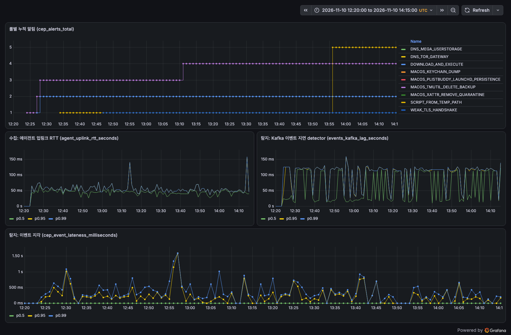
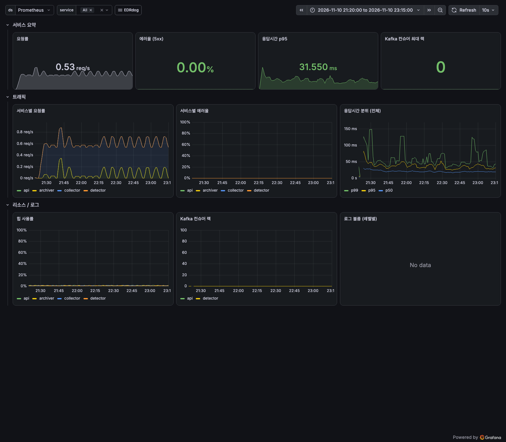

# KISA EDR 성능평가 항목 자체 시험 결과 (2026-11-10)

KISA 단말 이상행위 탐지 및 대응(EDR) 제품 성능평가 항목 V1.4 를 기준으로 EDRdog 를 직접 시험했다. 기준 원문과 출처 증거는 `../kisa-edr-performance-criteria.md`.

공식 성능평가가 아니다. KISA 공격 시나리오와 악성 시료는 공개되지 않아 ATT&CK 기법을 흉내 내는 양성 스크립트로 대신했다. 숫자는 아래 조건에서만 유효하다.

## 시험 조건

| 항목 | 값 |
|---|---|
| 서버 | 로컬 kind(Kafka, ClickHouse, MySQL, otel-lgtm) + 호스트 bootRun 6개, 코드 dev `29bf78e` |
| 단말 | macOS 맥북 1대, 설치된 에이전트(2026-08-20 빌드)의 설정만 로컬 서버로 돌림 |
| 시나리오 | 탐지 기대 10개(D01~D10) + 미탐 기대 6개(M01~M06). `scripts/detection-test/` |
| 측정 창 | detector 기동(12:16 UTC) 10분 뒤 시작. 시나리오 간격 330초 |
| 시험 시각 | 2026-11-10 12:27~14:11 UTC 본 시험, 14:29 UTC D01 재시험 |
| 배경 | 같은 맥에서 다른 작업이 돌고 있었다(M04 보정 참고). 다른 단말은 없었다 |

## 항목별 판정

| 항목 | 내용 | 판정 | 근거 |
|---|---|---|---|
| EDR-BF-14 (필수) | 단말 행위 수집 | **부분 통과** | 16개 중 15개 수집. 시작부터 수집까지 2.7~5.9초. D03(사용자 LaunchAgents 파일 생성)은 수집 0건(아래 결함 1) |
| EDR-BF-15 (필수) | 수집 정보로 공격 탐지·분석 | **통과** | 노린 기법 10개 중 9개 탐지, 시작부터 알림까지 3~10초. 놓친 D03 은 탐지가 아니라 수집 단계 문제 |
| EDR-BF-16 (필수) | 대응 정책에 따른 대응 | **통과** | D01 재시험에서 CRITICAL 알림 → kill 요청 → `KILLED` 까지 4초, 프로세스 소멸 확인(`result-d01-rerun.md`) |
| EDR-SE-01 (필수) | 알려진 악성 행위 탐지율 70% 이상 | **통과(대체 시료 기준)** | 노린 기법 기준 9/10 = 90%. 규칙이 노리지 않는 흔한 기법까지 넣은 16개 기준은 9/16 = 56.3% |
| EDR-EF-01 (필수) | 분석 서버 재시작 시간 | 미측정 | 이번 시험 범위 밖 |
| EDR-BF-01~13, 19, 20 | 인증, 잠금, 감사기록, 세션 등 기능 항목 | 이번 시험 범위 밖 | 코드 기준 예비 판정은 필수 9개 실패(`../nis-requirements-review.md` 와 같은 빈 곳) |

SE-01 을 두 숫자로 적는 이유: KISA 는 알려진 악성 시료만 실행해 잰다. 노린 기법 10개가 그 조건에 가깝다. 16개 기준은 규칙 범위 밖 기법을 일부러 넣어 실제 커버리지를 보인 값이다.

## 시나리오별 결과

`result.md`(본 시험 원본 표와 보정), `result-d01-rerun.md`(D01 재시험), `run.log`, `run-aborted.log`.

| ID | 기법 | 수집 | 탐지 | 대응 |
|---|---|---|---|---|
| D01 | 다운로드 후 실행 | O | DOWNLOAD_AND_EXECUTE (CRITICAL) | 재시험에서 KILLED |
| D02 | 임시 경로 스크립트 | O | SCRIPT_FROM_TEMP_PATH | 알림만(규칙이 notify) |
| D03 | 자동실행 경로 파일 | X | X | - |
| D04 | 약한 TLS | O* | WEAK_TLS_HANDSHAKE | 알림만 |
| D05 | 키체인 덤프 | O | MACOS_KEYCHAIN_DUMP | 알림만 |
| D06 | quarantine 제거 | O | MACOS_XATTR_REMOVE_QUARANTINE | 알림만 |
| D07 | PlistBuddy 지속성 | O | MACOS_PLISTBUDDY_LAUNCHD_PERSISTENCE | 알림만 |
| D08 | 백업 삭제 | O | MACOS_TMUTIL_DELETE_BACKUP | 알림만 |
| D09 | Tor 게이트웨이 DNS | O* | DNS_TOR_GATEWAY | 알림만 |
| D10 | MEGA 저장소 DNS | O* | DNS_MEGA_USERSTORAGE | 알림만 |
| M01~M06 | 사용자·시스템·프로세스 조회 등 | O | 없음(예상대로) | - |

\* 러너는 명령행의 표식으로 수집을 확인하는데 TLS·DNS 이벤트에는 명령행이 없다. 알림이 났으므로 수집된 것으로 판정했다.

## 증거

### 룰별 알림이 시나리오 시각에 맞춰 늘어난다 (Grafana, otel-lgtm)

### 시험 중 서비스 상태: 5xx 0%, Kafka 랙 0 (Grafana EDRdog Overview)

### 시험 구간 알림 원본 (ClickHouse `alerts`)

`evidence/alerts-clickhouse.txt`. 1~3행은 시험 도구 자신이 만든 오탐이다(아래 결함 2).

## 시험으로 드러난 결함

1. **사용자 LaunchAgents 감시가 동작하지 않는다 (BF-14).** 에이전트는 LaunchDaemon(root)으로 돌고 plist 에 `HOME` 이 없다. 서버가 내려주는 `~/Library/LaunchAgents` 의 `~` 를 `os.UserHomeDir()` 로 펴지 못해 경로가 그대로 남고, 커널의 절대 경로와 맞지 않는다(`agent/internal/sensor/eslogger_map.go` ExpandWatchPaths, `collector-service/.../agent/SensorConfig.java`). KISA Go 점검 F12 와 같은 문제다.
2. **명령행 부분 문자열 규칙의 오탐.** MACOS_TMUTIL_DELETE_BACKUP 이 `sed ... D08-tmutil-delete.sh` 와 `mv D08-tmutil-delete.sh D08.sh` 에도 걸렸다. 파일 이름에 `tmutil`, `delete` 가 들어 있었을 뿐이다. SCRIPT_FROM_TEMP_PATH 는 임시 경로 venv 의 `pip install`(정상 개발 작업)에 걸렸다.

결함은 이 PR 에서 고치지 않았다. `docs/exec-plans/tech-debt.md` 에 남긴다.

## 시험 도구 쪽에서 고친 것

- 러너가 시나리오 헤더를 `sed` 로 읽어 파일 이름이 명령행에 실리며 오탐을 만들었다. 시나리오 파일 이름을 ID 만 남기고 헤더를 bash 로 읽게 바꿨다.
- 판정을 시간 창 안의 아무 알림이 아니라 시나리오가 노린 규칙이 났을 때만 탐지로 세게 바꿨다.
- D01 의 `/tmp` 복사본 `/bin/sleep` 은 서명 검사로 macOS 가 바로 SIGKILL 했다(종료 코드 137 직접 재현). 임시 서명(`codesign -f -s -`)을 넣어 kill 대상이 살아 있게 했다.
- api-service 호출에 `X-API-Key` 헤더를 넣었다.
