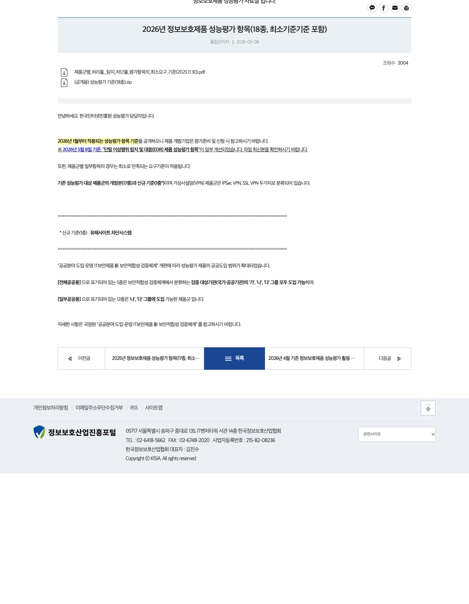
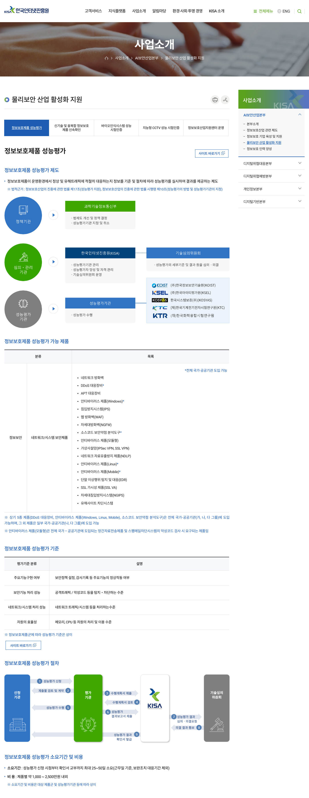
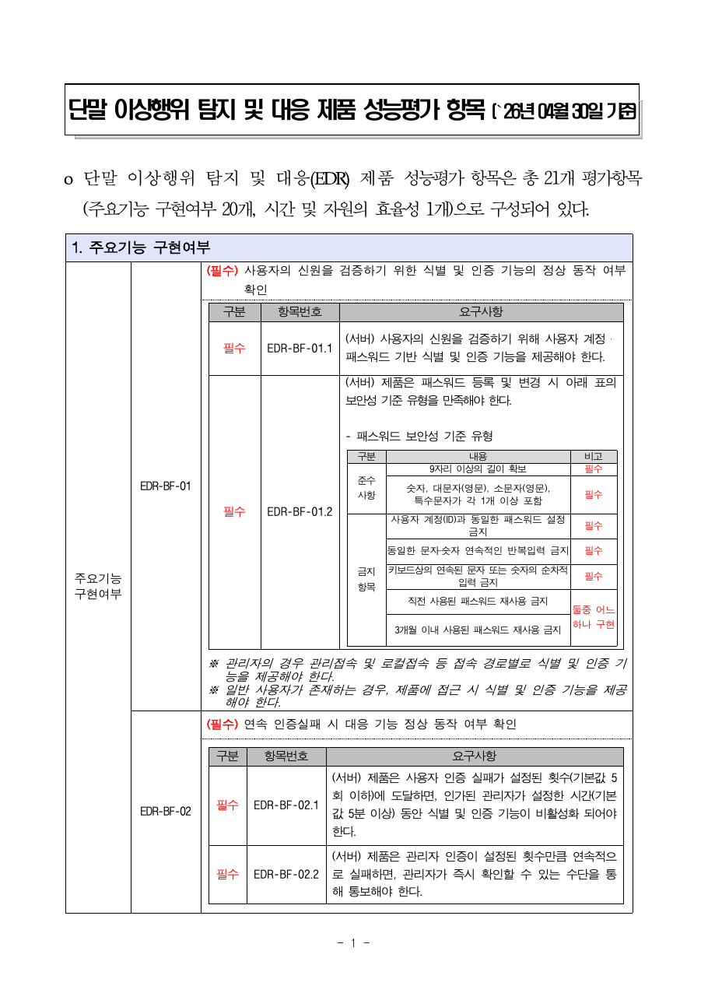
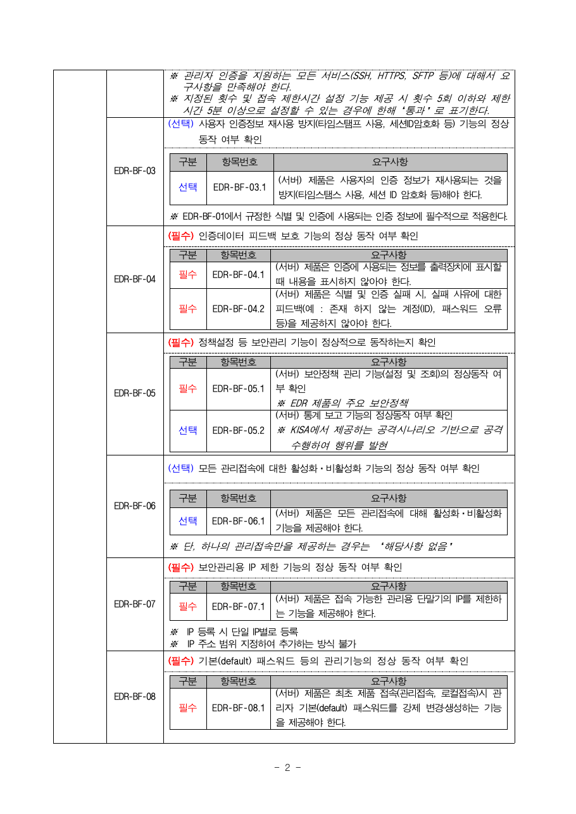
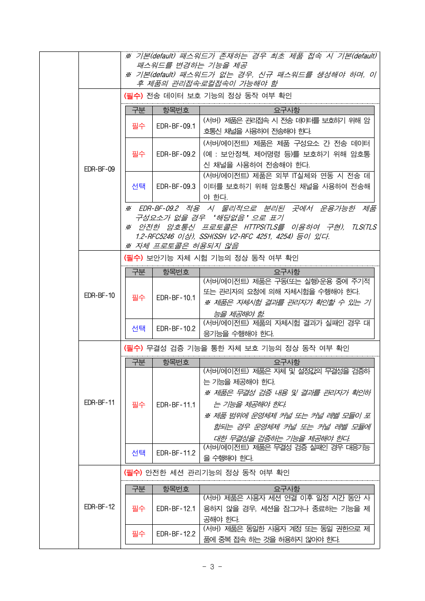
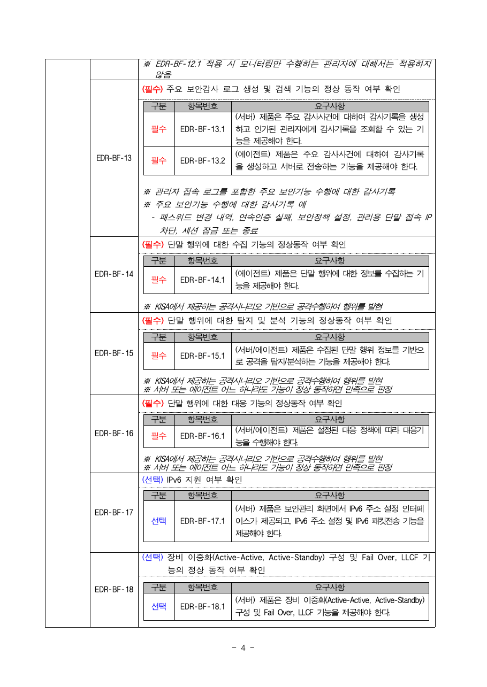
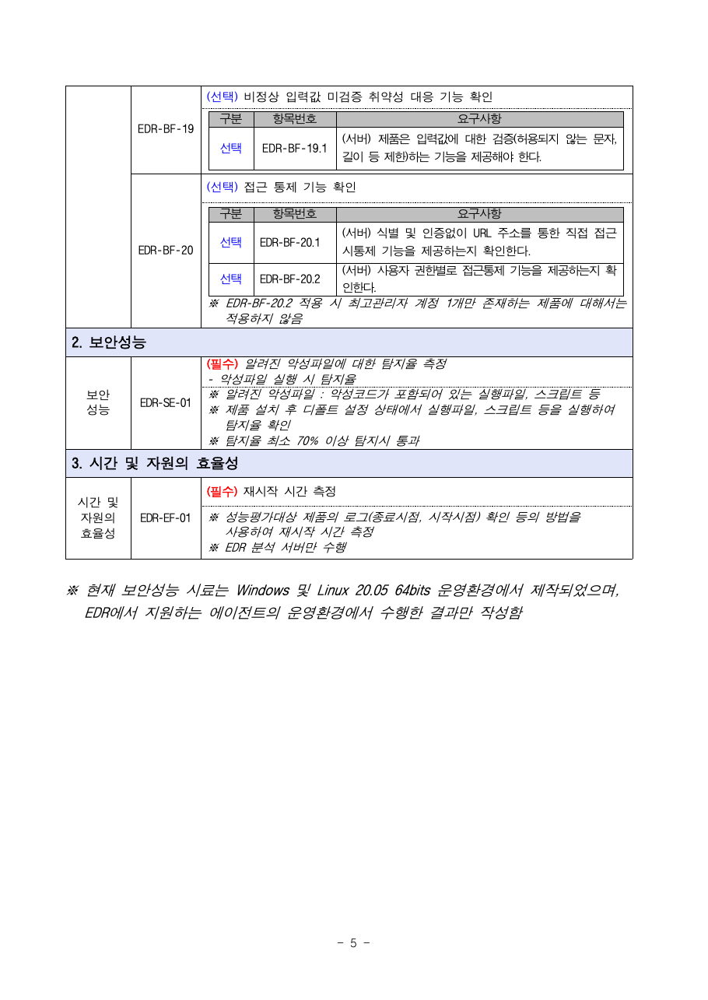
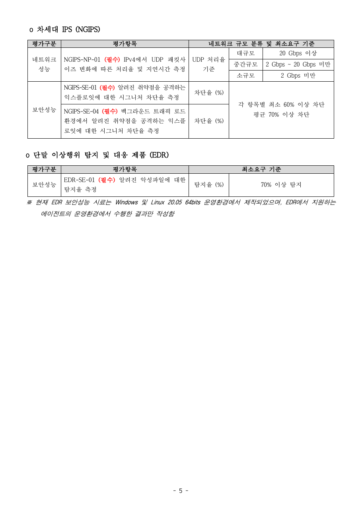

# KISA EDR 성능평가 항목 (직접 시험의 기준)

EDRdog 를 KISA 성능평가에 내는 것이 아니라, 같은 기준으로 직접 시험해 보려고 기준 원문을 정리하고 증거를 남긴다.

- 기준: 단말 이상행위 탐지 및 대응(EDR) 제품 성능평가 항목 V1.4 (2026-05-08 개정, 2026-04-30 기준 표기)
- 출처: 정보보호산업진흥포털 자료실 "2026년 정보보호제품 성능평가 항목(18종, 최소기준기준 포함)" (등록 2026-05-08)
  https://www.ksecurity.or.kr/user/bbs/kisis/25/87/bbsDataView/34637.do
- 제도 소개: KISA 정보보호제품 성능평가 https://www.kisa.or.kr/1041501
- 확인일: 2026-11-10. 원문 파일 SHA-256
  - `(공개용) 성능평가 기준(18종).zip`: `8fe56ede417240a2b53eb1f00e9b5c500cc57436500b428324e6c8b023e63f95`
  - 그 안의 `15. ... (EDR) 제품 성능평가 항목 V1.4(2026.05.08).pdf`: `56c9f873e30198f3c10c487ea8b441b2d941559734c82de18f76790225d800d6`
  - `제품군별_처리율__탐지_차단율_평가항목의_최소요구_기준(2025.11.30).pdf`: `8ed0d01fcda0b687bb33cb219f74385e4fe1992df7eba7b4ffad697884ae6f02`

## 요약

EDR 기준에는 부하테스트처럼 처리량을 재는 항목이 없다. 실제로 재는 성능 항목은 악성파일 탐지율과 서버 재시작 시간 두 가지다.

## EDR 성능평가 항목 (총 21개)

| 구분 | 항목 | 직접 해 볼 수 있나 |
|---|---|---|
| 보안성능 | EDR-SE-01 알려진 악성파일(실행파일, 스크립트) 실행 시 탐지율을 잰다. 기본 설정에서 70% 이상이면 통과 | 공식 시료는 KISA 만 갖고 있다. 공개된 공격 재현 방식으로 비슷하게 잰다 |
| 효율성 | EDR-EF-01 분석 서버 재시작 시간을 로그의 종료 시각과 시작 시각으로 잰다 | 바로 된다. detector 재시작 직후 지연(Kafka Streams 복원)이 이 항목에 해당한다 |
| 핵심 기능 | BF-14 수집, BF-15 탐지·분석, BF-16 대응. KISA 가 주는 공격 시나리오를 실행해서 확인한다 | 시나리오가 공개돼 있지 않다. ATT&CK 기법으로 우리 쪽 시나리오를 만들어 대신한다 |
| 기능 구현 | BF-01~13, 19, 20: 비밀번호 정책(9자 이상, 4종류 문자), 5회 실패 시 5분 잠금, 실패 사유를 알려주지 않기, 관리 IP 제한, 기본 비밀번호 강제 변경, 구성요소 간 TLS, 자체시험, 무결성 검증, 유휴 세션 종료, 중복 접속 차단, 감사기록, 권한별 접근통제 | 통과·실패 체크리스트다. 국정원 대조(`nis-requirements-review.md`)의 빈 곳과 거의 같다 |

주의: 원문은 보안성능 시료를 Windows 와 Linux 64bit 환경에서 만들었다고 적는다. EDRdog 에이전트의 주 대상은 macOS 라서 같은 시료를 그대로 쓸 수 없다.

## 증거

### 1. 기준 공개 게시글 (2026-05-08, EDR 항목 개정 공지)

### 2. KISA 제도 소개 (EDR 이 평가 대상 제품군, 평가기준 4분류)

### 3. EDR 성능평가 항목 V1.4 원문 (5쪽)

### 4. 최소요구 기준 (EDR-SE-01 탐지율 70% 이상)

## 캡처 방법

- 웹 페이지 1, 2: 헤드리스 Chrome 스크린샷 (2026-11-10)
- PDF 3, 4: 원문 PDF 를 `pdftoppm -r 110` 으로 PNG 변환
