# KISA EDR 보안 기능 항목 자체 시험 결과 (2026-11-11)

KISA 단말 이상행위 탐지 및 대응(EDR) 제품 성능평가 항목 V1.4 의 보안 기능 항목을 EDRdog 로컬 스택에서 직접 시험했다. 기준 원문과 출처는 `../kisa-edr-performance-criteria.md`, 계획은 `docs/exec-plans/completed/kisa-edr-security-functions.md`, 앞선 탐지 시험은 `../detection-test-2026-11-10/README.md`.

공식 성능평가가 아니다. 아래 숫자와 판정은 이 조건에서만 유효하다. 로컬 합성 환경이고 운영 실측이 아니다.

## 시험 조건

| 항목 | 값 |
|---|---|
| 서버 코드 | 1차 시험: Backend dev `34fd0c9`(PR #323 머지). 재시험: dev `650ebda`(PR #324 머지, 후속 수정). 서비스 6개 |
| 서버 구성 | 로컬 kind(MySQL, Kafka, ClickHouse, otel-lgtm). api-service 는 jar 로 실행(8084, 자체시험 주기 2분, 무결성 기준값은 `sha256sum` 파일), collector(8082, 에이전트 TLS 9443), detector, archiver, alert, responder 는 bootRun |
| 화면 코드 | Frontend `feat/#102-kisa-security-admin`(`3b5ef3f`, dev 의 `8e5ff6a` 머지가 가져온 내용과 같다) |
| 단말 | macOS 맥북 1대. dev 최신 빌드 에이전트가 root launchd 작업으로 동작(host `kisa-eval-mac`, tenant 1). 전체 디스크 접근 권한이 없어 eslogger 센서가 멈춰 있다 |
| 평가용 조직 | 회원가입 화면으로 새로 만든 tenant 8(admin 1, viewer 4). 데모 계정과 `DEMO_SEED` 는 쓰지 않았다(ADR 031, 평가 범위 밖) |
| 브라우저 | 헤드리스 Chrome(Playwright) 1440x900. 로그인이 필요한 화면은 실제 로그인 흐름을 거쳐 찍었다 |
| 시험 시각 | 1차 2026-11-11 06:28 ~ 06:42 KST(2026-11-10 21:28 ~ 21:42 UTC). 서버 시각과 같은 로컬 시계 |
| 재시험 | #324 머지 코드. 통보 시험은 2026-11-11 07:03 ~ 07:07 KST(22:03 ~ 22:07 UTC, 조정자가 수행), 통계 화면, 요청자 가림, webhook 비우기 확인은 07:09 KST(22:09 UTC, 이 문서 작성자가 수행) |
| 재시험 구성 | api-service 를 #324 코드 jar 로 바꿔 다시 띄우고 무결성 기준값 파일도 새 jar 로 다시 만들었다. Slack 대역으로 로컬 HTTPS 수신기(`https://localhost:9987`, 자체 서명 인증서를 JVM truststore 에 넣음)를 썼다. tenant 1 조직 webhook 은 `https://localhost:9987/hook`, 서버 `SELFTEST_WEBHOOK_URL` 은 `https://localhost:9987/server` |
| 도구 | 응답은 curl 과 파이썬 urllib. 비밀번호, 세션 토큰, enroll secret, X-API-Key 값은 증거에 남기지 않았다 |

시험 환경에서 시나리오와 다르게 한 것.

- 프론트 dev 서버를 5173 이 아니라 5174 로 띄웠다. 5173 은 다른 작업의 dev 서버가 쓰고 있어 건드리지 않았다. 백엔드 CORS 허용 출처가 5173 뿐이라(`application.yml` 의 `CORS_ALLOWED_ORIGINS`) 브라우저의 `/api` 요청은 Origin 헤더만 5173 으로 바꿔 대신 보냈다. 화면 코드와 서버 코드는 그대로다.
- 반복 API 호출 일부(비밀번호 유형 표, 입력값 검증, 인증 없는 접근)는 보조 에이전트(haiku)가 첫 판을 만들었고, 빠지거나 틀린 칸은 직접 다시 시험해 덧붙였다.

## 항목별 판정

판정은 원문 문구 기준이다. 1차 시험에서 부분이던 3개(BF-09.2, BF-10.2, BF-11.2)는 #324 와 재시험 뒤 통과로 바꿨다. 실패와 부분은 없다. 바뀐 칸은 표에 `재시험` 으로 적었다.

| 항목 | 원문 요구(요약) | 판정 | 근거 한 줄 | 증거 |
|---|---|---|---|---|
| BF-01.1 (필수) | 계정과 패스워드 기반 식별·인증 | 통과 | 가입 후 로그인, 로그아웃이 되고 이후 요청에 Bearer 가 필요하다 | `bf01-signup-done-dashboard.png`, `bf03-session-token.txt` |
| BF-01.2 (필수) | 9자 이상, 4종 문자, ID 와 같음·3연속·키보드 순차·직전 재사용 금지 | 통과 | 가입 규칙 거부 11개(유형별), 변경 때 직전 재사용 거부, 규칙 충족 값은 등록 201 | `bf01-password-matrix.txt`, `bf01-signup-*.png`, `bf01-password-change-*.png` |
| BF-02.1 (필수) | 연속 실패 5회 이하에서 5분 이상 인증 비활성 | 통과 | 5회 실패 뒤 맞는 비밀번호도 401, 5분 뒤(06:34:03) 로그인 200. 횟수 1~5, 시간 5~1440분만 설정되는 정책 | `bf02-lockout-api.txt`, `bf02-lock-release.txt`, `bf05-policy-api.txt` |
| BF-02.2 (필수) | 연속 실패 시 관리자가 즉시 확인할 수단으로 통보 | 통과 | 감사기록 `auth_lockout` 이 잠금 순간 남고 화면에서 조회된다. webhook 이 있는 조직은 발송을 시도한다(수신 확인은 못 함) | `bf02-audit-lockout.png`, `bf02-slack-attempt.txt` |
| BF-03.1 (선택) | 인증 정보 재사용 방지 | 통과 | 로그아웃한 토큰은 401, DB 에는 SHA-256 16진수 64자만 있고 토큰 원문으로는 0행 | `bf03-session-token.txt` |
| BF-04.1 (필수) | 인증 정보를 화면에 표시하지 않음 | 통과 | 비밀번호 칸이 `type=password` 이고 점으로만 보인다 | `bf04-login-masked.png` |
| BF-04.2 (필수) | 실패 사유(없는 계정, 틀린 비밀번호)를 알리지 않음 | 통과 | 없는 계정, 틀린 비밀번호, 잠긴 계정이 상태 401 과 본문이 같고 화면 문구도 같다 | `bf04-login-failure-responses.txt`, `bf04-login-fail-*.png` |
| BF-05.1 (필수) | 보안정책 설정·조회 | 통과 | 조회·변경 화면, 범위 밖 값은 400, 변경은 이전·이후 값이 감사기록 `security_policy_change` | `bf05-policy-*.png`, `bf05-policy-api.txt` |
| BF-05.2 (선택) | 통계 보고 | 통과(재시험) | tenant 1 대시보드에 알림 55건(2026-11-10 탐지 시험 알림 포함)이 총계, 심각도, 위협 유형 TOP 5, 위협 탐지 추이로 보이고 탐지 시험이 노린 룰 10개가 모두 들어 있다 | `bf05-stats-dashboard.png`, `bf05-stats-threats.png`, `bf05-stats-report.txt` |
| BF-06 (선택) | 관리접속 활성·비활성 | 해당 없음 | 관리접속이 웹 하나뿐이다(원문 단서) | |
| BF-07.1 (필수) | 관리용 IP 제한, 단일 IP 등록, 범위 불가 | 통과 | 단일 IP 등록, 범위·CIDR·와일드카드는 400, 목록 밖 주소의 로그인은 403 과 `admin_ip_block` | `bf07-admin-ip.txt`, `bf07-*.png` |
| BF-08.1 (필수) | 최초 접속 시 기본 패스워드 강제 변경 | 통과 | admin 이 만든 viewer 는 첫 로그인에서 변경 화면만 열리고 다른 API 는 403 `password_change_required`. 가입자는 기본 패스워드가 없다(원문 단서) | `bf08-forced-change-api.txt`, `bf08-force-*.png` |
| BF-09.1 (필수) | 관리접속 암호통신 | 통과 | 운영 관리 주소가 TLS 1.3 으로 핸드셰이크한다. 로컬 api 는 http 라 운영 주소 핸드셰이크만 확인했다(한계 참고) | `bf09-admin-https-prod-handshake.txt` |
| BF-09.2 (필수) | 구성요소 간 암호통신 | 통과(재시험) | 원문 단서(물리적으로 분리된 곳에서 운용 가능한 구성요소가 없으면 해당없음)에 따라 판정한다. 물리적으로 떨어져 운용되는 구성요소는 에이전트뿐이고 에이전트와 서버는 TLS 1.2, 1.3 이며 1.1 이하는 거절한다. 서버 서비스 6개는 한 클러스터 안에서만 함께 운용되는 관리 서버 하나의 구성요소로 본다(사용자 결정). 서버 내부 호출은 http 로 남아 있다(한계 참고) | `bf09-agent-tls.txt` |
| BF-09.3 (선택) | 외부 연동 암호통신 | 통과 | Slack webhook URL 은 https 만 받는다(http 는 400) | `bf09-webhook-https-only.txt` |
| BF-10.1 (필수) | 주기 또는 요청 시 자체시험, 결과 확인 | 통과 | 서버: 이력 API 에 기동 1, 주기 28, 요청 4건이 있고 화면은 최근 20건을 보인다. 에이전트: 60초마다 `security_check` 가 감사기록으로 서버에 온다 | `bf10-bf11-server-selftest.txt`, `bf10-server-selftest*.png`, `bf10-agent-security-check-fail.png` |
| BF-10.2 (선택) | 자체시험 실패 시 대응 | 통과(재시험) | 서버는 `[SELFTEST-FAIL]` 경고 로그, 운영 상태 `selftest` 줄 down, 감사기록, 운영 웹훅 통보. 에이전트는 실패 감사기록, 로그, 조직 웹훅 통보(재기동 직후 한 번, 같은 실패는 반복 통보하지 않음). 자동 복구는 없다 | `bf10-bf11-server-selftest.txt`, `bf10-bf11-notify-received.txt`, `bf10-agent-security-check-fail.png` |
| BF-11.1 (필수) | 자체와 설정값 무결성 검증, 결과 확인 | 통과 | 서버 기준값을 한 글자 바꾸면 지금 실행이 FAIL, 되돌리면 PASS. 에이전트 설정에 빈 줄을 더하면 25초 안에 실패 감사기록 | `bf11-server-*.png`, `bf11-agent-tamper.txt`, `bf11-agent-integrity-check.png` |
| BF-11.2 (선택) | 무결성 실패 시 대응 | 통과(재시험) | 서버: FAIL 화면, 경고 로그, 운영 웹훅 통보. 에이전트: 설정 변조 다음 주기에 실패 감사기록과 조직 웹훅 통보(기준·현재 해시 포함), 원복 다음 주기에 회복 통보. 자동 복구는 없다 | `bf11-server-integrity-fail.png`, `bf11-agent-tamper.txt`, `bf10-bf11-notify-received.txt` |
| BF-12.1 (필수) | 유휴 세션 잠금 또는 종료 | 통과 | 유휴 1분 정책에서 135초 뒤 첫 요청이 401, 감사기록 `session_terminate`(idle) | `bf12-session.txt`, `bf12-idle-*.png`, `bf12-audit-session-terminate.png` |
| BF-12.2 (필수) | 같은 계정 중복 접속 금지 | 통과 | 두 번째 로그인이 첫 세션을 끊는다. 첫 세션은 401, 감사기록 `duplicate` | `bf12-session.txt`, `bf12-duplicate-terminated.png` |
| BF-13.1 (필수) | 감사기록 생성과 관리자 조회 | 통과 | 가입, 로그인, 로그아웃, 비밀번호 변경, 잠금, 정책, IP, 세션, 접근 거부가 남고 화면에서 기간·유형·행위자·결과로 거르고 시각으로 정렬한다 | `bf13-audit-*.png` |
| BF-13.2 (필수) | 에이전트 감사기록 생성과 서버 전송 | 통과 | `agent_start`, `agent_enroll`, `security_check`, `integrity_check` 가 tenant 1 감사기록에 host 이름으로 보인다 | `bf13-agent-start.png`, `bf13-agent-enroll.png`, `bf10-agent-security-check-fail.png`, `bf11-agent-integrity-check.png` |
| BF-14.1 (필수) | 단말 행위 수집 | 통과(인용) | `../detection-test-2026-11-10/` 결함 수정 후 재시험 기준 | 인용 보고서 |
| BF-15.1 (필수) | 탐지·분석 | 통과(인용) | 노린 기법 10/10 탐지(수정 후) | 인용 보고서 |
| BF-16.1 (필수) | 대응 | 통과(인용) | D01 알림에서 kill 까지 4초, 프로세스 소멸 | 인용 보고서 |
| BF-17 (선택) | IPv6 | 범위 밖 | 보안 기능이 아니다. 제공하지 않는다 | |
| BF-18 (선택) | 이중화 | 범위 밖 | 보안 기능이 아니다. 제공하지 않는다 | |
| BF-19.1 (선택) | 입력값 검증 | 통과 | 길이 초과, 제어문자, 범위 밖, 형식 오류가 400 과 한국어 메시지. 5xx 0건, 스택트레이스 0건 | `bf19-input-validation.txt` |
| BF-20.1 (선택) | 인증 없는 URL 직접 접근 통제 | 통과 | 관리 API 15개가 토큰 없음과 무효 토큰에서 401. 비로그인 화면 주소는 로그인 화면으로 돌아간다 | `bf20-url-access.txt`, `bf20-unauth-audit-redirect.png` |
| BF-20.2 (선택) | 권한별 접근통제 | 통과 | viewer 는 조회 API 200, 대응·설정·감사·자체점검·IP·계정 API 가 403 이고 `access_denied` 가 남는다. 메뉴의 PLATFORM 묶음이 숨겨진다 | `bf20-viewer-api.txt`, `bf20-viewer-*.png`, `bf20-audit-access-denied.png` |
| SE-01 (필수) | 알려진 악성 행위 탐지율 70% 이상 | 통과(인용) | 대체 시료 기준 10/10(수정 후). 공식 시료가 아니다 | 인용 보고서 |
| EF-01 (필수) | 분석 서버 재시작 시간 | 측정 | 종료 신호부터 새 프로세스 Started 중앙값 4.70초, Kafka Streams RUNNING 중앙값 46.09초(3회, 로컬) | `ef01-detector-restart.txt` |

집계(재시험 반영): 통과 29(탐지 시험 인용 4 포함), 부분 0, 실패 0, 해당 없음 1(BF-06), 범위 밖 2(BF-17, BF-18), 측정 1(EF-01). 1차 시험은 통과 25, 부분 3, 범위 밖 3 이었다.

## 증거

### BF-01 비밀번호 규칙

가입 화면은 규칙 8개를 보여 주고 어기면 가입 버튼이 꺼진다. 아래는 키보드 순서(`qwe`)를 어긴 경우다.

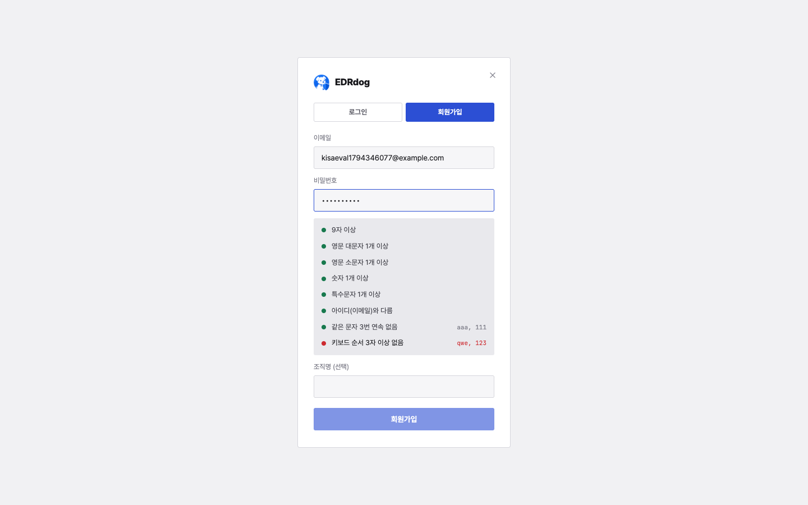

서버 응답(`bf01-password-matrix.txt` 발췌). 화면 검사를 우회해도 서버가 같은 규칙으로 거부한다.

```
[1] 길이 부족(8자)   | 400 | 패스워드는 9자 이상이어야 합니다
[3] 대문자 없음      | 400 | 패스워드에는 숫자, 영문 대문자, 영문 소문자, 특수문자가 각각 1개 이상 들어가야 합니다
[6] 같은 문자 3연속  | 400 | 같은 문자나 숫자를 3번 이상 연속해서 쓸 수 없습니다
[7] 키보드 순차      | 400 | 키보드에서 연속된 문자나 숫자를 3개 이상 순서대로 쓸 수 없습니다
[8-a] 아이디와 같음  | 400 | 패스워드는 계정(ID)과 같을 수 없습니다
[9] 정상             | 201
[10] 직전 비밀번호 재사용(변경) | 400 | 직전에 사용한 패스워드는 다시 쓸 수 없습니다
```

재사용 금지는 두 선택지 중 직전 비밀번호를 골랐다(ADR 031). 변경 화면에서도 같다.

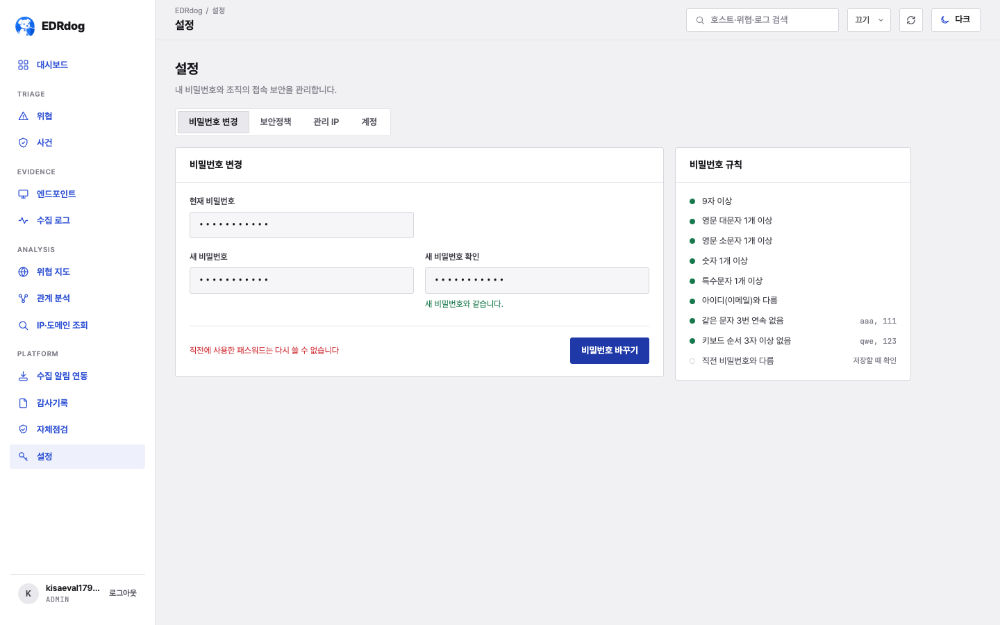

처음 8번은 이메일 형식 때문에 시험이 안 돼 아이디와 같은 비밀번호를 이메일 전체, `@` 앞부분, 대소문자만 바꾼 값 세 가지로 다시 시험했다. 모두 거부됐다.

### BF-02 연속 실패 잠금과 통보

대상은 admin 이 만든 viewer 한 계정. 정책은 기본값(5회, 5분).

```
[실패 1~5] 틀린 비밀번호  | HTTP 401 | 이메일 또는 비밀번호가 올바르지 않습니다
[잠금 뒤]  맞는 비밀번호  | HTTP 401 | 이메일 또는 비밀번호가 올바르지 않습니다
[DB] locked_until 2026-11-10 21:33:52 UTC (06:28:52 KST 잠금 시작 + 5분)
[해제 뒤 06:34:03] 맞는 비밀번호 | HTTP 200 (mustChangePassword true)
```

해제는 실제로 5분을 기다려 확인했다(`bf02-lock-release.txt`). 같은 시각 잠긴 다른 계정은 5분이 지나기 전이라 401 이었다.

잠금은 바로 감사기록 `auth_lockout` 으로 남고 admin 이 화면에서 본다.

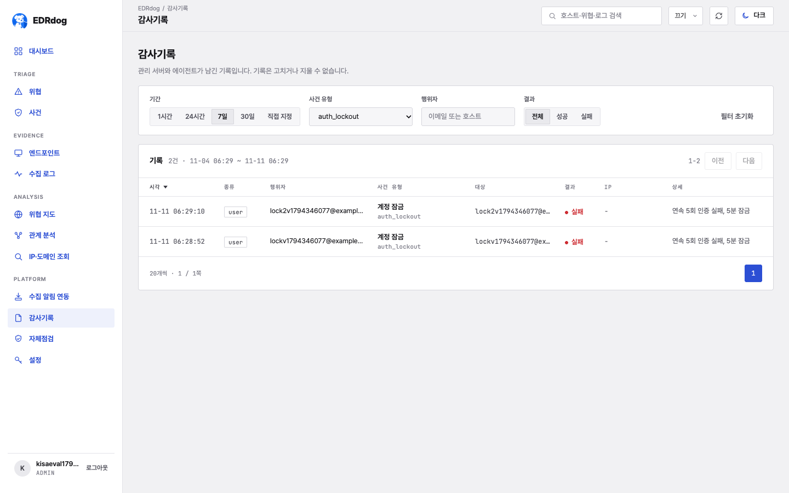

Slack 통보는 조직 webhook 이 있을 때 보낸다. 로컬에는 Slack 도 https 수신기도 없어서 webhook 을 `https://localhost:9987/slack-eval` 로 두고 발송 시도만 봤다. 잠금 순간 api-service 가 POST 를 시도했고 연결 거부 경고가 남았으며 로그인 흐름은 깨지지 않았다(`bf02-slack-attempt.txt`). 웹훅이 없는 조직(첫 잠금 시험)은 감사기록만 남는다. 실제 Slack 도달은 확인하지 못했다.

BF-09.3 근거: webhook 을 `http://127.0.0.1:9987/slack` 로 저장하려 하자 `400 webhook URL 은 https:// 로 시작해야 합니다` 로 거절됐다(`bf09-webhook-https-only.txt`).

### BF-03 세션 토큰

```
[1] 로그인 | HTTP 200 | 응답 토큰 길이 43자, URL-safe base64
[2] DB sessions 에서 토큰 원문으로 찾은 행 수 = 0, 토큰의 SHA-256 으로 찾은 행 수 = 1
[3] DB 저장 형식: token_len 64, is_sha256_hex 1
[6] 로그아웃한 토큰으로 GET /api/auth/me | HTTP 401
[8] 로그아웃 뒤 DB 에서 그 토큰의 SHA-256 행 수 = 0
```

### BF-04 인증 데이터 피드백 보호

로그인 화면은 비밀번호를 점으로 가린다. 로그인 칸 아래에 계정마다 달라지지 않는 안내(연속으로 틀리면 계정이 일시 잠깁니다)만 있다.

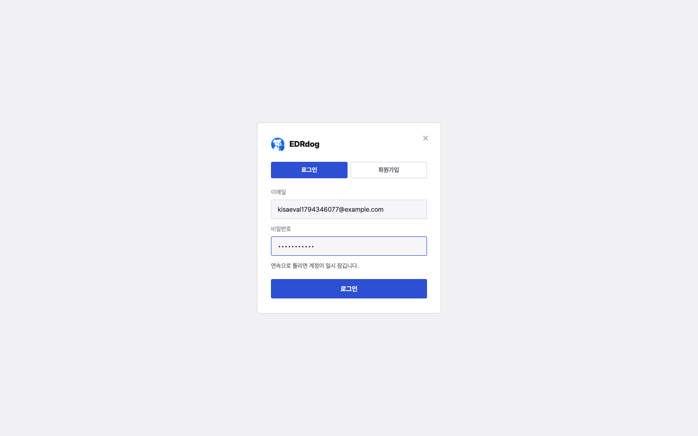

세 경우의 응답이 같다(`bf04-login-failure-responses.txt`).

```
없는 계정                    | HTTP 401 | {"error":"이메일 또는 비밀번호가 올바르지 않습니다"}
존재하는 계정 + 틀린 비밀번호   | HTTP 401 | {"error":"이메일 또는 비밀번호가 올바르지 않습니다"}
잠긴 계정 + 맞는 비밀번호      | HTTP 401 | {"error":"이메일 또는 비밀번호가 올바르지 않습니다"}
본문 동일: True, 상태 동일: True
```

화면 문구도 세 경우 모두 `로그인하지 못했습니다. 이메일과 비밀번호를 확인하세요.` 로 같다(`bf04-login-fail-unknown.png`, `bf04-login-fail-wrongpw.png`, `bf04-login-fail-locked.png`). 응답 시간은 재지 않았다.

### BF-05 보안정책

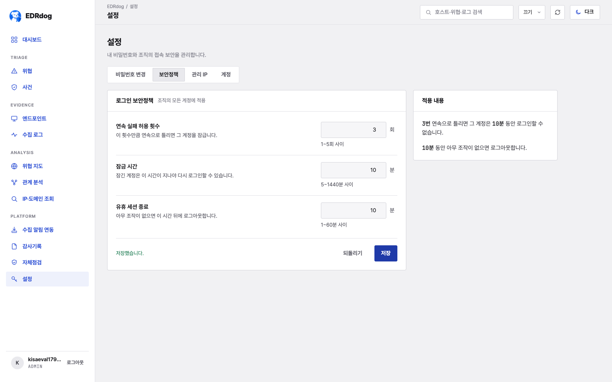

범위 밖 값은 자르지 않고 거절한다.

```
PUT {maxLoginFailures:6, ...}  | 400 | maxLoginFailures 는 1~5 여야 합니다
PUT {..., lockMinutes:4, ...}  | 400 | lockMinutes 는 5~1440 여야 합니다
PUT {..., idleMinutes:61}      | 400 | idleMinutes 는 1~60 여야 합니다
```

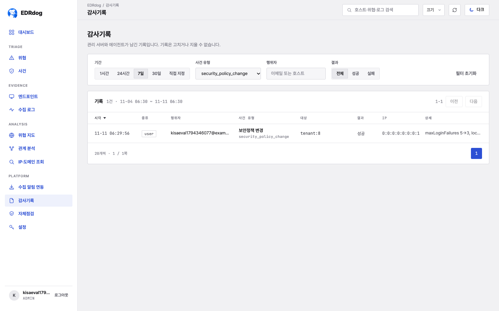

### BF-05.2 통계 보고 (재시험)

원문에서 BF-05.2 는 선택 항목이다(1차 표의 필수 표기는 틀렸고 고쳤다). tenant 1(dettest)로 로그인한 대시보드에 탐지 통계가 보인다. 같은 조직에 평가용 에이전트와 2026-11-10 탐지 시험의 알림이 들어 있다.

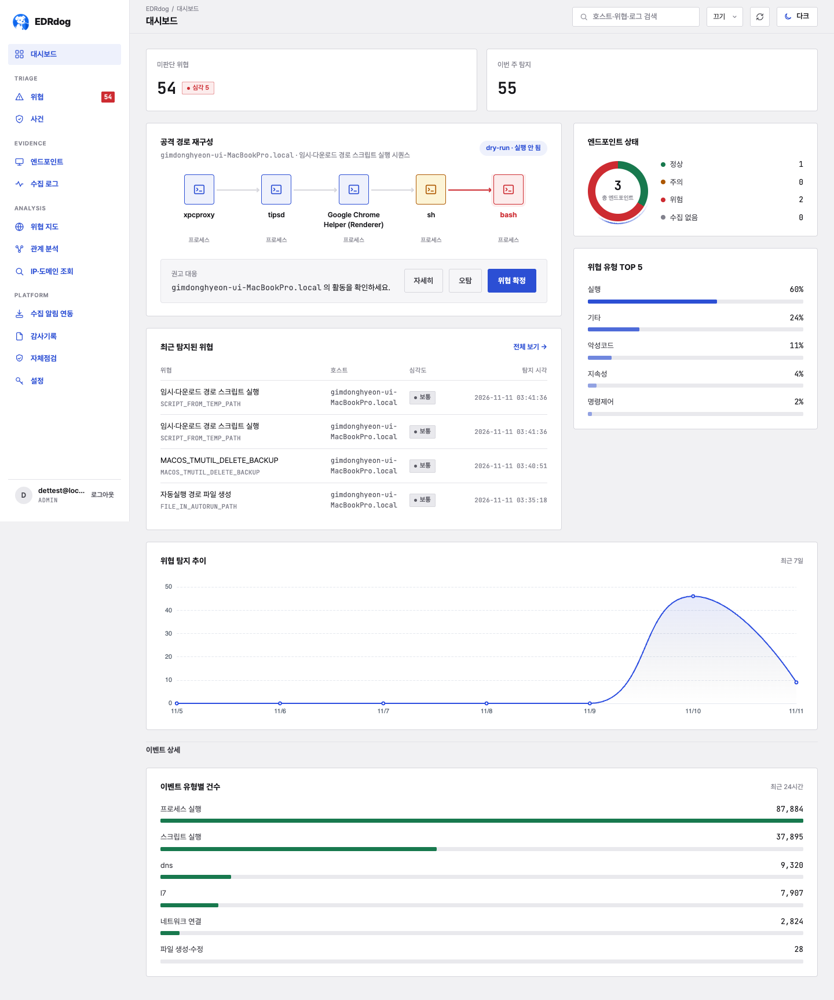

```
GET /api/alerts/summary | 200 | total 55, severity critical 6 / high 0 / medium 49,
                                 topThreats 실행 33, 기타 13, 악성코드 6, 지속성 2, 명령제어 1
GET /api/alerts         | 200 | 55건, 가장 이른 2026-11-10 12:23:53 UTC (탐지 시험 시작), 가장 늦은 2026-11-10 18:41:36 UTC
룰별: SCRIPT_FROM_TEMP_PATH=33, MACOS_TMUTIL_DELETE_BACKUP=7, DOWNLOAD_AND_EXECUTE=6, FILE_IN_AUTORUN_PATH=2, MACOS_KEYCHAIN_DUMP=2,
      DNS_MEGA_USERSTORAGE=1, DNS_TOR_GATEWAY=1, MACOS_PLISTBUDDY_LAUNCHD_PERSISTENCE=1, MACOS_XATTR_REMOVE_QUARANTINE=1, WEAK_TLS_HANDSHAKE=1
탐지 시험(D01~D10)이 노린 룰 10개 중 통계에 나온 것: 10/10
```

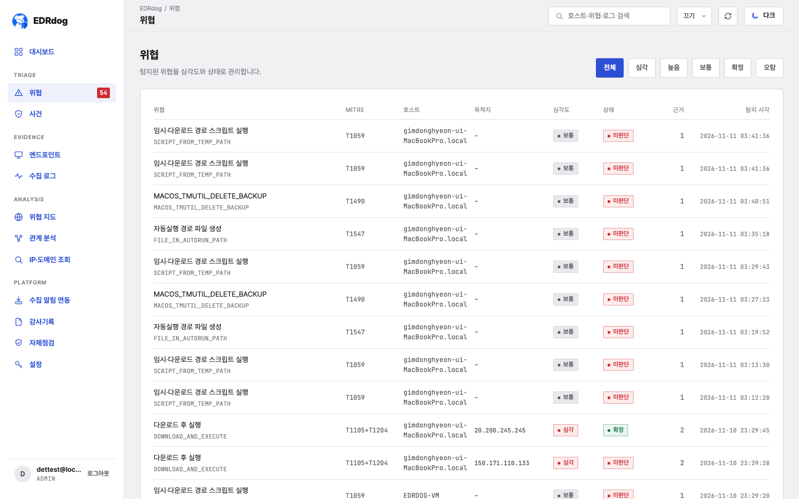

기간은 기본(대시보드 이번 주, 위협 추이 최근 7일)이라 늘릴 필요가 없었다. 판정 근거는 통계가 화면에 보인다는 점이다. 이 통계의 알림에는 탐지 시험 뒤 같은 맥에서 다른 작업(개발 중 스크립트 실행 등)이 낸 알림도 섞여 있어 55건 전부가 탐지 시험 시나리오의 결과는 아니다(탐지 시험 보고서 참고). 조직 이름이나 기간을 바꾼 보고서(PDF 등) 출력은 시험하지 않았다.

### BF-07 관리 IP 제한

로컬에서는 루프백 두 주소를 서로 다른 단말로 썼다. 화면이 보는 주소 `::1` 만 등록하고, 다른 주소 `127.0.0.1` 에서 로그인을 시도했다.

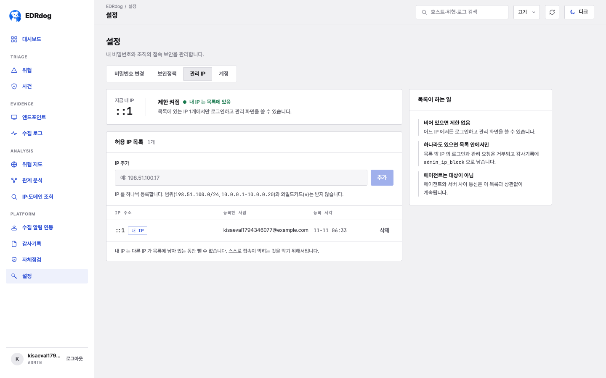

```
[UI] 범위(10.0.0.0/8) 입력: 범위, 와일드카드, 여러 개는 등록할 수 없습니다. IP 하나만 입력하세요.
[UI] 본인 IP 가 아닌 첫 IP 입력: 처음 등록하는 IP 는 지금 내 IP(::1)여야 합니다.
[1] 목록 밖 IP 에서 맞는 비밀번호로 로그인   | 403 | 허용되지 않은 IP 입니다
[2] 목록 밖 IP 에서 틀린 비밀번호로 로그인   | 403 | 허용되지 않은 IP 입니다  (비밀번호를 보기 전에 막힌다)
[복구] 목록을 비우고 같은 주소에서 로그인     | 200
```

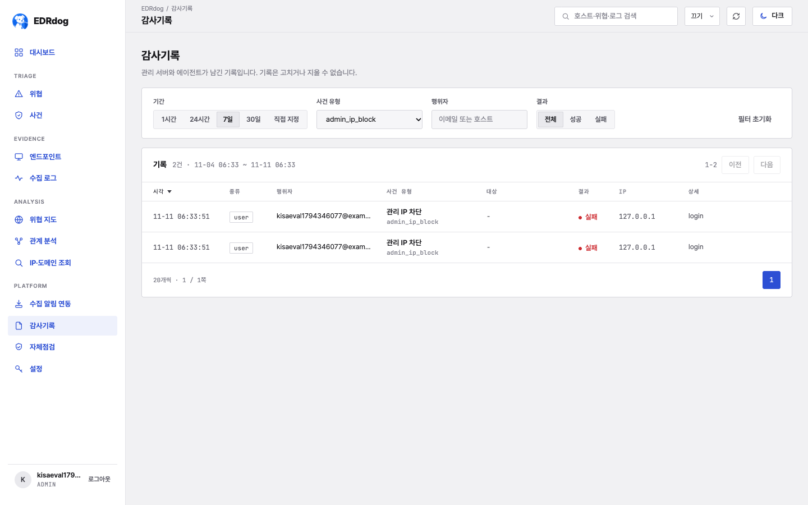

### BF-08 기본 패스워드 강제 변경

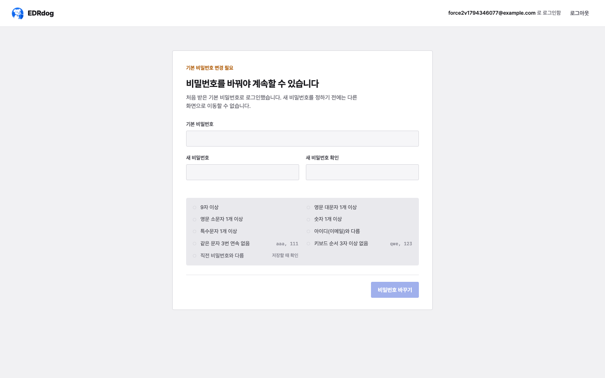

```
[1] 첫 로그인 | 200 | role viewer, mustChangePassword true
[2] GET /api/alerts (강제 변경 중) | 403 | {"error":"패스워드를 변경해야 다른 기능을 쓸 수 있습니다","code":"password_change_required"}
[4] GET /api/auth/me (허용 경로)    | 200
[7] 규칙 충족 새 값으로 변경          | 204
[9] GET /api/alerts (변경 뒤)        | 200
[10] 옛 비밀번호로 로그인             | 401
```

### BF-09 암호통신

```
$ openssl s_client -connect localhost:9443 </dev/null        (collector 에이전트 포트)
    Protocol  : TLSv1.3     Cipher : AEAD-CHACHA20-POLY1305-SHA256
$ ... -tls1_2  → TLSv1.2 (ECDHE-RSA-CHACHA20-POLY1305)
$ ... -tls1_1, -tls1 → 거절(protocol version alert)

$ openssl s_client -connect edrdog-api.duckdns.org:30443 -servername edrdog-api.duckdns.org </dev/null   (핸드셰이크만, 요청 없음)
    Protocol  : TLSv1.3     Cipher : AEAD-CHACHA20-POLY1305-SHA256
```

BF-09.2 판정 근거는 원문 단서다. 물리적으로 분리된 곳에서 운용 가능한 구성요소가 없으면 해당없음이라고 적혀 있다. 에이전트는 사용자 단말에서 떨어져 운용되므로 에이전트와 서버 사이는 TLS 로 시험했고 통과다. 서버 서비스 6개(api, collector, detector, archiver, alert, responder)는 한 클러스터 안에서만 함께 운용되므로 하나의 관리 서버 구성요소로 본다. 이 해석은 사용자 결정이다. 서버 내부 호출은 http 이고 이 사실은 `한계` 에 남겼다.

### BF-10, BF-11 서버 자체점검과 무결성

기동 직후 1건(STARTUP), 2분 주기, 지금 실행 세 경로가 한 화면에 보인다.

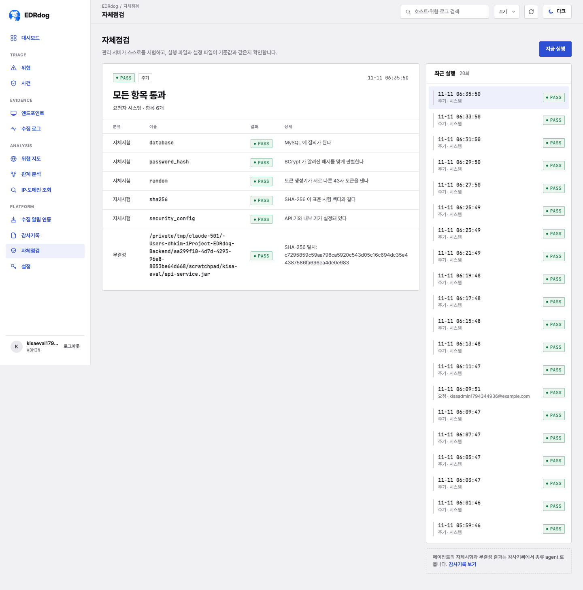

위 화면은 1차 시험(#323 코드)이다. 최근 실행 목록에 다른 조직 admin 이메일이 그대로 보인다(06:09 요청 한 줄). #324 이후 모습은 아래 요청자 가림 절에 있다.

무결성 기준값 파일(`baseline.sha256`)의 첫 해시 첫 글자를 `c` 에서 `0` 으로 바꾸고 지금 실행하자 FAIL 이 났다. 되돌린 뒤 PASS 로 돌아왔다.

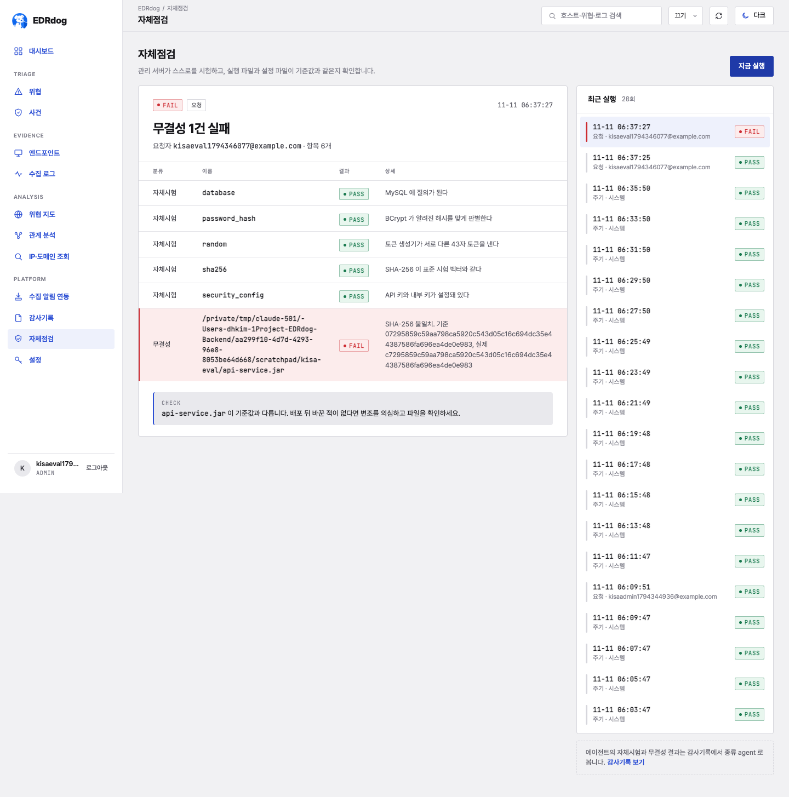

```
[변조 후 지금 실행] FAIL  integrity /…/api-service.jar  SHA-256 불일치. 기준 07295859c59a... 실제 c7295859c59a...
[운영 상태 health 의 selftest 줄] status down, error 자체시험 실패: …/api-service.jar
[복구 뒤 지금 실행] PASS  SHA-256 일치: c7295859c59a...
```

변조한 시각의 주기 실행은 없었다(다음 주기 전에 되돌렸다). 실패 기록 1건(id 32, MANUAL)이 이력에 남아 있다.

### BF-10.2, BF-11.2 능동 통보와 요청자 가림 (재시험)

재시험은 #324 코드 jar 와 로컬 HTTPS 수신기로 했다. 수신 기록은 `evidence/bf10-bf11-notify-received.txt`(UTC 시각, 이메일 없음, 해시는 시험용 설정 파일 것)이다. 사실대로 적는다.

| 시각(UTC / KST) | 한 일 | 받은 통보 |
|---|---|---|
| 22:03:45 / 07:03:45 | api-service 재기동 직후 에이전트 `security_check` 실패(eslogger 권한 없음) | 조직 webhook 으로 한 건. 수신기가 청크 본문을 읽지 못하던 때라 본문이 비어 있다(수신기 문제, 이후 고침). 같은 실패가 매 분 와도 더 보내지 않았다 |
| 22:05:45 / 07:05:45 | 에이전트 `config.json` 에 빈 줄 하나 추가 | 다음 주기에 `에이전트 무결성 검증 실패` 통보(기준과 현재 해시 포함) |
| 22:06:45 / 07:06:45 | 원복(원복 뒤 sha256 이 원본과 같고 권한 600) | 다음 주기에 `에이전트 무결성 검증 회복` 통보 |
| 22:07:18 / 07:07:18 | 서버 기준값 파일 한 글자 변조 후 지금 실행 | FAIL 과 `서버 자체시험 실패 (MANUAL)` 통보(운영 웹훅). 원복(`cmp` 로 원본과 같음 확인) 후 지금 실행 PASS. 서버는 회복 통보를 보내지 않는다(실패 항목 집합이 바뀔 때만 보냄, ADR 029) |

에이전트 첫 통보의 본문이 빈 것은 수신기가 청크 전송을 읽지 못해서였고 전송 자체는 22:03:45 에 받았다. 본문 없이 도달만 확인한 것이므로 이 통보의 문구는 확인하지 못했다. 뒤의 세 통보는 본문까지 확인했다.

판정은 통과다. 서버와 에이전트 모두 실패 시 로그, 상태 화면, 감사기록, 조직 또는 운영 웹훅 능동 통보를 한다. 자동 복구(파일 되돌리기, 재설치, 서비스 중지)는 없다. 변조된 jar 는 서버가 스스로 복구할 수 없고 종료하면 크래시 루프가 되기 때문이다(ADR 029). 같은 실패는 반복 통보하지 않고 집합이 바뀔 때만 보내는 설계다.

자체점검 요청자 가림(발견 3의 해결 확인). #324 로 다른 조직 요청자는 `다른 조직 관리자` 로 가려진다. tenant 8 admin 에게 같은 화면이 더 이상 다른 조직 이메일을 보이지 않는다.

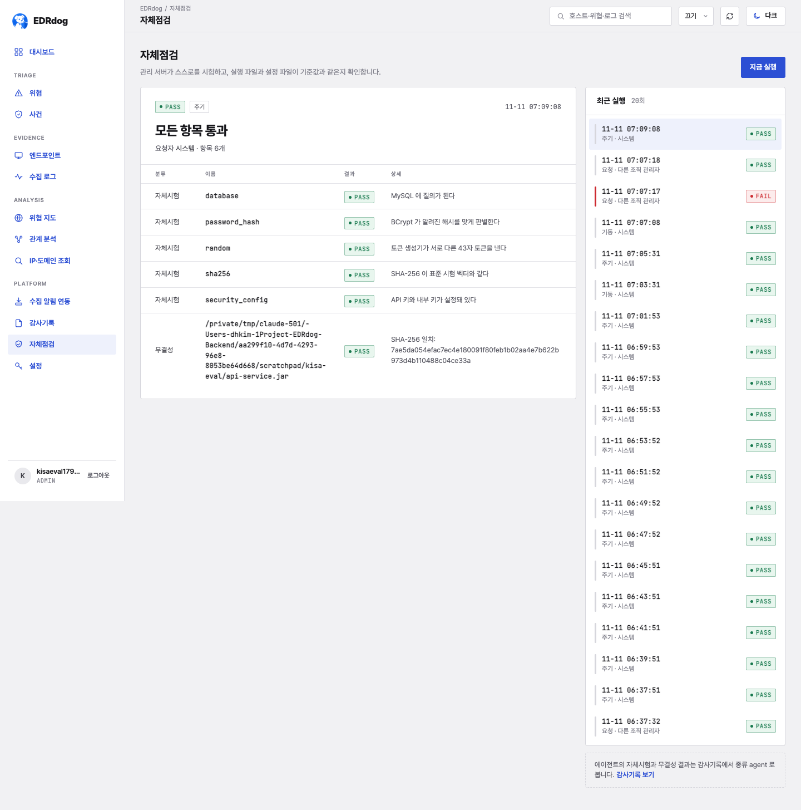

```
[tenant 8 admin 이 지금 실행] 화면에 본인 이메일 표시 True, 다른 조직 이메일 노출 False
[tenant 8 API] 요청자 있는 기록: id 53 본인 이메일, id 51 다른 조직 관리자, id 50 다른 조직 관리자, id 33~31, 17 다른 조직 관리자
[tenant 1 API] id 51, 50 본인 이메일, id 53 다른 조직 관리자
```

#324 이전에 만든 요청 기록(id 17, 31, 32, 33)은 요청 조직이 기록돼 있지 않아 본인 조직 요청도 다른 조직 관리자 로 가려진다(안전한 쪽으로 가림). 증거는 `bf10-selftest-requester-masking.txt`, `bf10-server-selftest-own-requester.png`, `bf10-server-selftest-tenant1-view.png`.

webhook 비우기(발견 4의 해결 확인). tenant 1 admin 이 `DELETE /api/tenant/webhook` 으로 재시험용 webhook 을 비웠다.

```
[1] 비우기 전 GET | 200 | webhookUrl https://localhost:9987/hook
[2] DELETE        | 204
[3] 비운 뒤 GET   | 200 | webhookUrl null
[5] 감사기록 webhook_change | success, detail remove, target tenant
세션 없이 DELETE | 401
```

증거는 `bf-webhook-clear-api.txt`. 이 방식이 1차 시험에서 DB 를 직접 고치던 일을 대신한다.

### BF-10.1, BF-10.2, BF-13.2, BF-11.1 에이전트

에이전트는 이 시험 맥에서 eslogger 센서가 멈춰 있어 자체시험(`security_check`)이 매 분 실패로 보고된다. 이것이 BF-10.2 의 실제 사례다. 서버는 이 실패를 감사기록으로 받고 tenant 1 admin 이 화면에서 본다. 1차 시험에서는 여기까지만 있고 능동 통보가 없었으나 #324 이후 조직 webhook 통보가 붙었다(위 재시험).

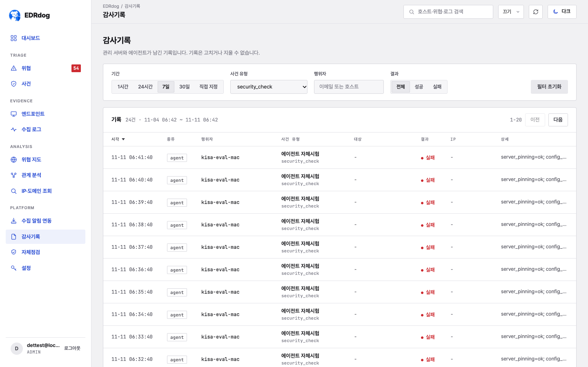

```
security_check  failure  server_pinning=ok; config_permission=ok; ca_cert_permission=ok; sensors=fail(멈춘 센서: eslogger)
```

에이전트는 실패해도 계속 돈다(멈추면 그 기기의 수집과 대응이 같이 멈춘다, ADR 030). 대응은 경고 로그와 감사기록 `failure` 다. 관리자에게 따로 밀어 주는 통보는 없다.

에이전트 설정 변조 시험(`bf11-agent-tamper.txt`). `config.json` 끝에 빈 줄 하나를 더했다.

```
06:36:15 변조(권한 600 유지, sha256 9385bbd089c2 -> 4c3f1b738574)
06:36:40 integrity_check failure  config_integrity=fail(기준값과 다르다 ...)   (변조 후 25초)
06:36:46 원래대로 되돌림(sha256 9385bbd089c2, 원본과 같음 True)
06:37:40 integrity_check success  config_integrity=ok(...)
```

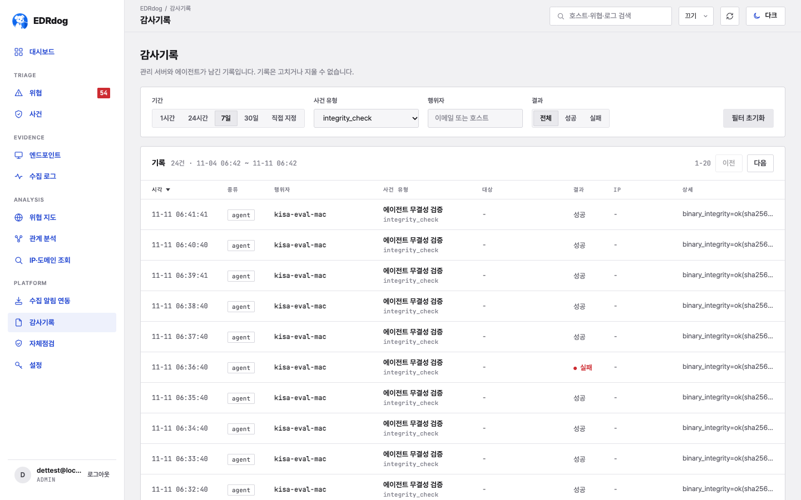

`agent_start`, `agent_enroll` 도 같은 화면에서 본다(`bf13-agent-start.png`, `bf13-agent-enroll.png`).

### BF-12 세션 관리

```
[1] 정책 idleMinutes 1
[2~4] 같은 계정으로 두 번 로그인하면 첫 세션 A 는 401, 두 번째 B 는 200
[6] viewer 로그인 후 마지막 조작 06:34:46. 135초 동안 조작하지 않는다
[7] 06:37:01 같은 토큰으로 GET /api/auth/me | 401
[감사] session_terminate  idle: 유휴 1분 초과로 종료
[감사] session_terminate  duplicate: 새 로그인으로 기존 세션 1개 종료
[복구] 정책 기본값(5, 5, 10) 으로 되돌림, GET 으로 확인
```

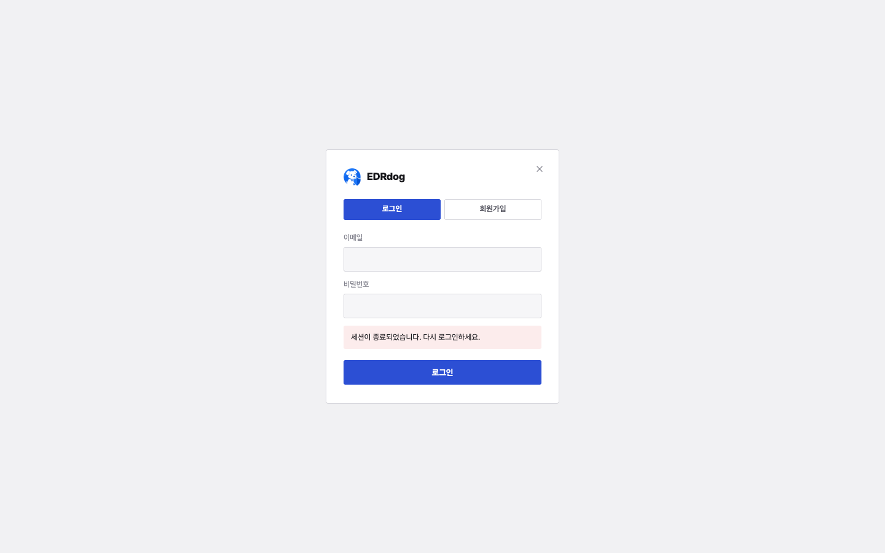

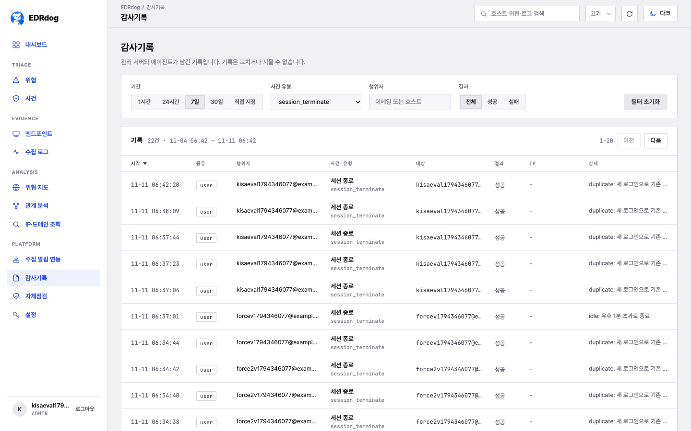

### BF-13.1 감사기록 화면

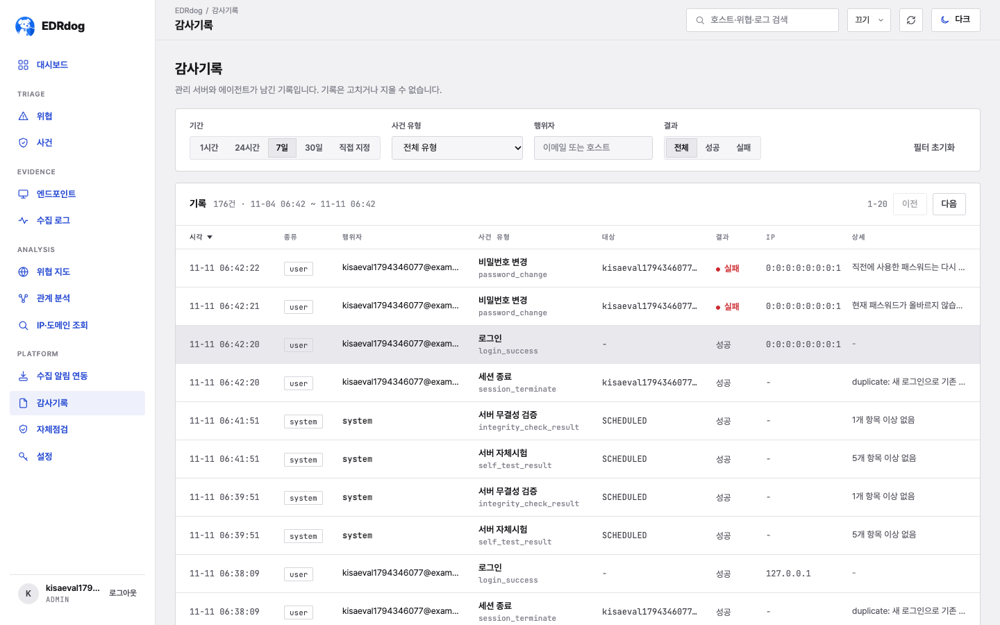

시각 정렬(`bf13-audit-sort-asc.png`), 결과 실패 필터(`bf13-audit-filter-failure.png`), 비밀번호 변경 필터(`bf13-audit-filter-password-change.png`)를 찍었다. 감사기록을 고치거나 지우는 화면과 API 는 없다.

### BF-19 입력값 검증

```
로그인 이메일 300자          | 400 | email 값이 너무 길거나 허용되지 않는 문자가 있습니다
로그인 이메일에 제어문자 NUL  | 400 | email 값이 너무 길거나 허용되지 않는 문자가 있습니다
가입 orgName 200자           | 400 | orgName 값이 너무 길거나 허용되지 않는 문자가 있습니다
가입 본문이 JSON 아님         | 400 | 요청 본문 형식이 올바르지 않습니다
정책 값 범위 초과             | 400 | maxLoginFailures 는 1~5 여야 합니다
GET /api/audit?offset=-5     | 400 | offset 은 0..10000 여야 합니다: -5
관리 IP 입력 CIDR, 와일드카드, 도메인, 범위, 여러 개, 300자 | 400 | IP 는 단일 주소(IPv4 또는 IPv6)만 등록할 수 있습니다...
```

요약: 응답 본문에서 `Exception`, `at com.`, `at org.`, `stacktrace` 가 나온 개수 0, 5xx 0. `GET /api/audit?limit=99999` 는 오류 없이 200 이다. 서버가 한 번에 돌려주는 개수를 상한 1000 으로 맞춘다(오류가 아니라 자르는 동작). 관리 IP 입력에 개행을 붙인 값은 공백으로 잘려 유효한 IP 로 읽혔고, 처음 등록 IP 가 본인이 아니라는 규칙(409)으로 거부됐다. 등록된 것은 없다.

### BF-20 접근통제

인증 없음과 무효 토큰 모두 관리 API 15개가 401 이다(첫 표 14개에 `GET /api/tenant/webhook` 1개를 더했다. `/api/tenant/*` 는 X-API-Key 를 먼저 보므로 키를 보내고 세션만 뺀 경우도 따로 시험해 401 이었다). `bf20-url-access.txt`.

```
GET /api/audit              | 인증 없음 401 | 무효 토큰 401 | 유효하지 않거나 만료된 토큰입니다
PUT /api/auth/security-policy | 401 | 401
POST /api/alerts/1/respond  | 401 | 401
```

비로그인으로 `/audit`, `/settings`, `/selftest` 를 열면 로그인 화면으로 돌아간다.

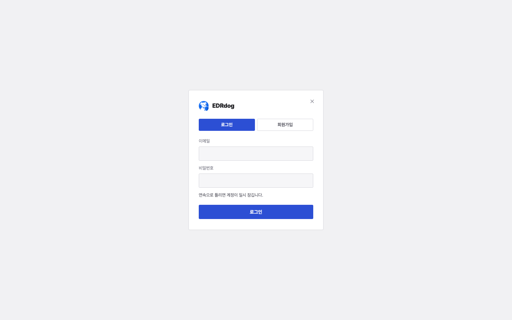

viewer 로 같은 API 를 부르면 조회는 되고 나머지는 403 이다(`bf20-viewer-api.txt`).

```
GET /api/alerts, /api/hosts (viewer 허용)                       | 200
GET /api/audit, /api/operations/selftest, /api/auth/security-policy | 403 권한이 없습니다
POST /api/alerts/1/respond (대응 kill), PATCH /api/alerts/1      | 403
GET, POST /api/tenant/admin-ips, POST /api/tenant/users          | 403
```

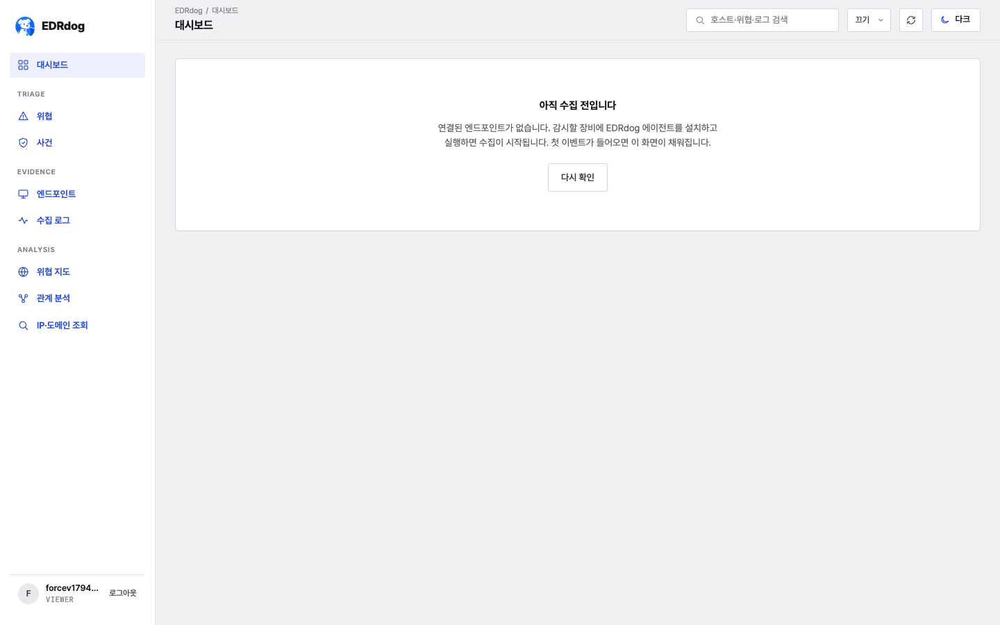

viewer 사이드바에는 PLATFORM 묶음(감사기록, 자체점검, 설정 등)이 없다. 주소로 직접 열면 서버의 403 이 `권한이 없습니다` 로 보인다(`bf20-viewer-audit.png`, `bf20-viewer-selftest.png`). 거부는 감사기록 `access_denied` 로 남는다(`bf20-audit-access-denied.png`).

### EF-01 분석 서버 재시작 시간

대상은 detector-service(Spring Boot + Kafka Streams, Kafka 1대, 로컬). 정의를 둘로 나눠 적는다.

- 시작 지점: 종료 신호(SIGTERM) 전송 시각. 종료는 앱 JVM 에 직접 보냈다(서비스 정상 종료).
- 끝 지점 1, Started: 새 프로세스의 로그 `Started DetectorApplication`(HTTP 가 열리는 시점). 새 프로세스는 `start.sh` 의 detector 줄과 같은 명령(`SERVER_PORT=8081 ./gradlew -q :detector-service:bootRun`)으로 띄웠다. gradle 기동 시간이 포함돼 운영(jar)보다 길다.
- 끝 지점 2, RUNNING: Kafka Streams 클라이언트 `REBALANCING -> RUNNING`(실제로 이벤트를 다시 처리하는 시점, 상태 복원 포함).

| 회차 | 종료 | 기동 Started(Spring 보고) | SIGTERM → Started | SIGTERM → RUNNING |
|---|---|---|---|---|
| 1 | 1.06s | 3.88s (2.05s) | 5.09s | 46.99s |
| 2 | 0.42s | 4.13s (2.60s) | 4.70s | 45.94s |
| 3 | 0.79s | 3.16s (1.91s) | 4.10s | 46.09s |
| 중앙값 | 0.79s | 3.88s | 4.70s | 46.09s |

RUNNING 까지 걸린 40초 이상은 Kafka Streams 그룹 가입 대기다. 2회차 로그에서 가입 요청(06:39:06.9)부터 가입 완료(06:39:47.3)까지 40.4초, 상태 복원은 가입 직후 0.7초(체인지로그 3개, 복원 레코드 0건)였다. 이전 인스턴스가 그룹에서 빠지기를 기다린 것으로 보이고(`session.timeout.ms=45000`) 이 원인은 추정이다. 측정 조건: 같은 맥에서 다른 작업과 브라우저가 돌고 있었고 회차 사이 간격은 25초, 3회 모두 로컬 상태 디렉터리가 남은 재시작이다. 콜드 스타트(상태 디렉터리 없음)는 재지 않았다. KISA 원문은 기준값 없이 측정만 요구한다.

## 이 시험에서 발견한 것

1차 시험에서 5건이 나왔고 #324 로 3건이 해결됐다. 아래 해결 여부는 재시험으로 확인했다.

1. 서버 내부 서비스 간 호출이 http 다. 남았다. BF-09.2 는 원문 단서와 사용자 결정(서버 서비스 6개를 한 구성요소로 봄)으로 통과 처리했고, 내부 http 자체는 한계로 남긴다.
2. 자체시험 실패와 무결성 실패의 능동 통보 부족: 해결. 서버는 운영 웹훅, 에이전트는 조직 웹훅으로 실패와 회복을 통보한다(재시험 표).
3. 자체점검 결과가 다른 조직 admin 이메일을 보임: 해결. 다른 조직 요청자는 `다른 조직 관리자` 로 가려진다(재시험, `bf10-selftest-requester-masking.txt`).
4. 조직 webhook 을 API 로 비울 수 없음: 해결. `DELETE /api/tenant/webhook` 이 204 와 감사기록 `webhook_change` 를 남긴다(`bf-webhook-clear-api.txt`).
5. IP 제한 조직의 이메일로 목록 밖에서 로그인하면 403, 없는 이메일이면 401 이라 이메일이 제한 조직 소속인지 드러난다(ADR 033 에 적힌 대가). 남았다.

## 한계

- 로컬 단일 머신이고 운영 실측이 아니다. 에이전트가 센서가 멈춘 상태라 BF-14 수집은 이번에 다시 재지 않았다(인용).
- 서버 서비스 사이(api, collector, detector, archiver, alert, responder)의 호출은 클러스터 안 http 다. BF-09.2 는 이 서버 서비스들을 하나의 관리 서버 구성요소로 보는 해석(사용자 결정)에 기대어 통과로 적었다. 이 해석을 안 따르면 부분이 된다.
- api-service 가 http 라 BF-09.1 은 운영 주소의 핸드셰이크만 확인했다. 운영 인증서는 자체 서명이다(`Verify return code: 18`). 핸드셰이크 외 요청은 보내지 않았다.
- 운영 IP 제한은 프록시 주소를 본다. 운영은 Caddy 뒤라 `server.forward-headers-strategy` 가 설정되지 않으면 허용 IP 가 실제 단말 IP 가 아니라 프록시 주소와 비교된다(`docs/exec-plans/tech-debt.md`). 로컬 시험은 소켓 주소를 그대로 봤다.
- 유휴 종료는 다음 요청이 올 때 판정한다. 마지막 사용 시각 갱신이 1분 단위라 정책 시간에서 최대 1분 어긋난다. 화면이 자동 갱신으로 계속 API 를 부르면 세션이 살아 있다(ADR 032).
- Slack 통보는 진짜 Slack 이 아니라 로컬 HTTPS 수신기(대역)로 확인했다. 실제 Slack 도달과 Slack 쪽 서식은 확인하지 못했다. 에이전트 첫 통보의 본문은 수신기 문제로 비어 있어 문구를 확인하지 못했다.
- BF-20.2 의 화면 버튼 숨김은 알림 데이터가 평가 조직에 없어 버튼 자체를 찍지 못했다. 메뉴 숨김과 서버 403 만 직접 확인했고 버튼 숨김은 코드(`TriageActions.tsx`, `IncidentDetail.tsx`)로만 안다.
- BF-05.2 는 화면에 통계가 보이는지만 봤다. 보고서 파일 출력이나 기간 지정 보고서는 시험하지 않았다. 통계의 55건에는 탐지 시험 뒤 같은 맥의 다른 작업이 낸 알림이 섞여 있다.
- 데모 계정은 쓰지 않았다. 데모 계정은 BF-08, BF-12.2, BF-02 에서 의도적으로 빠진다(ADR 031, 032).
- 응답 시간(BF-04.2 의 시간 차이)은 재지 않았다.
- 시험 중 api-service 로그 파일(`logs/api-service.log`)이 06:20 의 두 번째 기동 시도(포트 사용 중으로 실패)에 한 번 잘려 널 문자가 섞였다. 증거의 로그 줄은 널 문자를 걷어내고 뽑았다.
- 모든 숫자는 3회 이하 반복이고 통계적 검정이 아니다.

## 시험 중 바꾼 것과 되돌린 것

| 바꾼 것 | 되돌린 방법 | 확인 |
|---|---|---|
| tenant 8 보안정책 5/5/10 → 3/10/10 → 5/5/1 → 5/5/10 | PUT 으로 기본값 | `bf12-session.txt` 의 `복구 확인` GET 이 `5, 5, 10` |
| tenant 8 허용 IP 목록(`::1` 한 건) | 화면에서 삭제 | DB `admin_ips` 의 tenant 8 행 수 0, 목록 밖이던 주소에서 로그인 200 |
| tenant 8 Slack webhook(`https://localhost:9987/slack-eval`) | API 로 비울 수 없어 `UPDATE tenants SET slack_webhook_url=NULL WHERE id=8` | `select` 로 NULL 확인 |
| 서버 무결성 기준값 파일 `kisa-eval/baseline.sha256` 첫 해시 한 글자 | 원본 사본으로 덮어씀 | 사본과 같음 True, 권한 644 그대로, 이어서 지금 실행 PASS |
| 에이전트 `kisa-eval/agent/config.json` 끝에 빈 줄 | 사본 내용으로 덮어씀(같은 파일, 권한 유지) | sha256 같음, 권한 600, 다음 주기 `integrity_check` PASS |
| detector 재시작 3회 | 마지막 프로세스를 그대로 둠 | health `UP`, 새 로그는 `kisa-eval/logs/detector-restart-3.log` 로 이어진다 |
| 재시험: api-service 를 #324 jar 로 교체, 기준값 파일 재생성, 서버 `SELFTEST_WEBHOOK_URL`, tenant 1 webhook, 수신기 9987(조정자) | 수신기와 `SELFTEST_WEBHOOK_URL` 은 재시험 구성이라 그대로 둠. 기준값 변조와 에이전트 설정 변조는 조정자가 원복(서버는 `cmp`, 에이전트는 sha256 과 권한 600 확인) | 조정자 보고 기준(`bf10-bf11-notify-received.txt`) |
| 재시험: tenant 1 webhook(`https://localhost:9987/hook`) | `DELETE /api/tenant/webhook` | 204, GET 이 null, 감사기록 `webhook_change` (`bf-webhook-clear-api.txt`) |
| 재시험: tenant 8 자체점검 지금 실행 1회(요청자 가림 확인용) | 이력 기록이라 되돌리지 않음 | 자체점검 이력 id 53 |

되돌리지 않고 남은 것(로컬 DB 에 쌓였고 지우는 API 가 없다): 평가 조직 tenant 8 의 계정 5개(admin 1, viewer 4)와 감사기록, 보조 에이전트가 만든 시험 계정 2조직(tenant 5, 6), 디버그 가입 1조직(tenant 7), 자체점검 이력의 FAIL 1건(id 32, 1차 시험)과 재시험 FAIL 기록. 에이전트의 일반 동작(60초 주기 점검, 감사기록 전송)은 시험 내내 멈추지 않았다.

## 배포 때 할 일

1. 운영 api-service 에 `server.forward-headers-strategy=native` 를 사람이 주입하고 Caddy 가 실제 단말 주소를 넘기는지 확인(BF-07 이 운영에서 쓸모 있으려면 필요).
2. CD 가 jar 의 `sha256sum` 을 기준값 파일로 마운트하고 `INTEGRITY_BASELINE_FILE` 을 준다(ADR 029). 그 전까지 운영의 서버 무결성은 SKIP 이다.
3. 운영에 `SELFTEST_WEBHOOK_URL` 과 조직별 Slack webhook 을 채우고 BF-02.2, BF-10.2, BF-11.2 통보가 진짜 Slack 에 도달하는지 한 번 확인한다(재시험은 로컬 수신기 대역).
4. 서버 서비스를 하나의 관리 서버 구성요소로 본 해석(BF-09.2)을 ADR 로 남기고, 서비스 간 통신이 클러스터 밖으로 나가지 않는다는 근거(네트워크 정책 등)를 적는다. 해석이 바뀌면 서비스 간 TLS 가 필요하다.
5. 배포하면 세션 토큰이 해시 저장으로 바뀌어 전원이 다시 로그인한다(ADR 032).
6. 운영 관리 주소 인증서를 신뢰되는 발급기관 것으로 바꾼다.
7. 자체점검 이력과 webhook 비우기는 #324 로 해결됐다. 남은 것은 발견 1(내부 http)과 5(IP 제한 조직 이메일 존재 노출)를 tech-debt 에서 추적하는 일이다.
